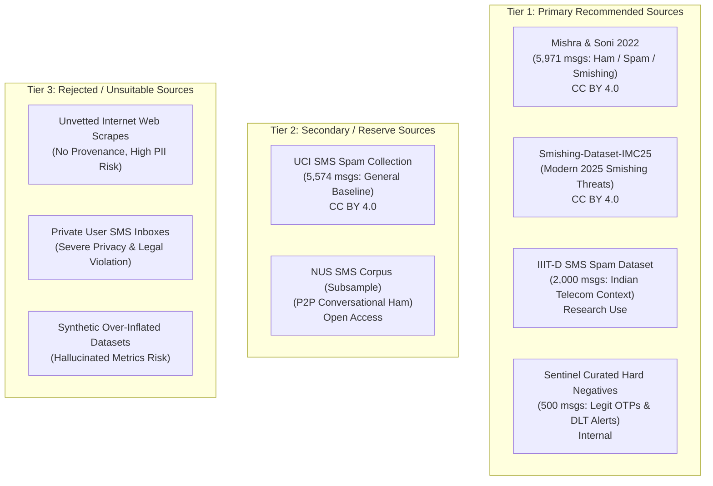

# Phase 2.2 Dataset Acquisition Plan

## 1. Objective

The objective of Phase 2.2 is to construct a high-quality, legally compliant, privacy-preserving, and empirically defensible training and evaluation dataset for Sentinel's Message ML subsystem.

Having hardened the Message ML foundation in Phase 2.1A (40/40 tests passing, MurmurHash3 parity verified, deterministic rules validated with zero false positives on synthetic OTP benchmarks, and template leakage prevention operational), the primary bottleneck is data volume and domain diversity. Phase 2.2 transitions Message ML from synthetic development fixtures to a multi-source, traceable, and representative dataset covering:
1. Indian banking, authentication OTP, delivery, and utility notifications.
2. Legitimate hard negatives containing urgent/alarming security terminology.
3. Realistic commercial and telemarketing spam.
4. Genuine smishing attack patterns (reverse OTP theft, fake KYC suspension, electricity cutoffs, UPI fraud, APK droppers).

---

## 2. Dataset Requirements

To support the 3-tier security classification taxonomy and 8-tier intent taxonomy defined in [`Messages-ml/data/schemas/taxonomy.json`](file:///c:/Users/user/Programing%20files/Yajat/Projects/sentinel-ml/Messages-ml/data/schemas/taxonomy.json), the acquired dataset must satisfy the following architectural criteria:

1. **Independent Intent & Security Labels**:
   - Must represent `BENIGN` transactional messages (e.g. `OTP_AUTH` + `BENIGN`, `BANKING_TRANSACTIONAL` + `BENIGN`, `DELIVERY` + `BENIGN`).
   - Must represent `MALICIOUS` security threats (e.g. `OTP_AUTH` + `MALICIOUS` for reverse OTP theft, `BANKING_TRANSACTIONAL` + `MALICIOUS` for fake KYC links).
   - Must represent `SUSPICIOUS_SPAM` for non-malicious commercial telemarketing (`PROMOTIONAL` + `SUSPICIOUS_SPAM`).

2. **Context-Aware Hard Negatives (The OTP & Alarming Words Requirement)**:
   - High density of legitimate messages containing alarming keywords: `OTP`, `blocked`, `suspended`, `unauthorized`, `penalty`, `KYC`, `PAN`, `due tonight`, `lock card`.
   - Clear contextual separation: legitimate protective warnings (`"Do not share OTP"`) vs. credential harvesting requests (`"Send OTP to executive"`).

3. **Indian Ecosystem Alignment**:
   - Authentic Indian mobile messaging structure, including TRAI DLT header formats (`VK-HDFCBK`, `AX-SBIINB`, `AD-UIDAIG`, `VM-AMAZON`).
   - Representation of Indian entities (State Bank of India, HDFC Bank, ICICI Bank, Axis Bank, UIDAI, Income Tax Dept, Swiggy, Zomato).
   - Representation of Indian payment mechanisms (UPI VPAs, UPI collect requests, debit/credit alerts in INR / ₹ / Rs).

4. **Provenance & Data Lineage**:
   - 100% of imported records must retain immutable source identifiers (`source_id`, `source_type`, license).

5. **Strict Privacy & PII Scrubbing**:
   - Zero raw phone numbers, credit card numbers, personal bank accounts, real user names, or live session OTPs stored in committed training data.

---

## 3. Candidate Sources

A comprehensive investigation of public academic, industry, and security corpora was conducted. Each candidate was evaluated across 16 dimensions:

### Candidate 1: Mishra & Soni SMS Phishing Dataset (Mendeley Data, 2022)
- **Source**: Mendeley Data (DOI: [10.17632/f45bkkt8pr.1](https://doi.org/10.17632/f45bkkt8pr.1))
- **Authors**: Sandhya Mishra, Dr. Devpriya Soni, Dr. Gunikhan Sonowal, Tiago A. Almeida
- **Publication**: *SMS Phishing Dataset for Machine Learning and Pattern Recognition* (2022)
- **License**: Creative Commons Attribution 4.0 International (CC BY 4.0) — Verified.
- **Permitted Usage**: Open for research, commercial, and redistribution with citation.
- **Size**: 5,971 records (4,844 ham, 489 spam, 638 smishing).
- **Labels**: 3-class (`ham`, `spam`, `Smishing`).
- **Language**: English (en).
- **Geographic Relevance**: International & Indian research context (includes contributions from Dr. Sonowal's mobile security research).
- **Sender Availability**: No separate header field; text contains body.
- **URL Availability**: Very High (over 90% of smishing examples contain malicious phishing links, shorteners, or IP addresses).
- **PII Status**: Partially masked; requires automated PII scrubbing.
- **Redistribution Status**: Permitted under CC BY 4.0.
- **Security Relevance**: Very High. Explicitly isolates smishing attacks from general spam.
- **Strengths**: Native 3-tier label taxonomy matching Sentinel's architecture; verified CC BY 4.0 license; well-vetted academic benchmark.
- **Weaknesses**: Lacks separate DLT sender headers; predominantly English.
- **Suitability Score**: **92 / 100** (Primary Recommended).

---

### Candidate 2: Smishing-Dataset-IMC25 (ACM IMC 2025)
- **Source**: GitHub (`reportsmishing/Smishing-Dataset-IMC25`)
- **Authors**: Sharad Agarwal, Antonis Papasavva, Guillermo Suarez-Tangil, Marie Vasek
- **Publication**: *Fishing for Smishing: Understanding SMS Phishing Infrastructure and Strategies by Mining Public User Reports* (ACM IMC 2025)
- **License**: CC BY 4.0 — Verified.
- **Permitted Usage**: Open research and dataset redistribution with attribution.
- **Size**: 12,500+ analyzed smishing messages extracted from 64,500 user reports.
- **Labels**: Granular threat metadata (phishing links, fake logistics, APK droppers, bank alerts).
- **Language**: Multilingual (English primary, French, Spanish, etc.).
- **Geographic Relevance**: Global empirical smishing campaigns (2023–2025).
- **Sender Availability**: Partial (sender phone numbers and alphanumeric sender tags recorded in report metadata).
- **URL Availability**: Extremely High (captures live phishing domains, drive-by APK download URLs, and URL shorteners).
- **PII Status**: User reports may contain reported numbers; strict automated PII scrubbing required.
- **Redistribution Status**: Permitted under CC BY 4.0.
- **Security Relevance**: Extremely High. Reflects modern 2024–2025 mobile threat tactics including Android malware droppers and parcel delivery smishing.
- **Strengths**: Fresh, modern threat patterns; captures APK dropper and delivery scam threat vectors.
- **Weaknesses**: Non-smishing ham messages must be sourced elsewhere (dataset focuses on malicious reports).
- **Suitability Score**: **88 / 100** (Primary Recommended for Malicious Class).

---

### Candidate 3: IIIT-D SMS Spam Dataset (SMSAssassin, 2011/2012)
- **Source**: IIIT Delhi / Precog Research Group ([precog.iiitd.edu.in](https://precog.iiitd.edu.in))
- **Authors**: Kuldeep Yadav, Ponnurangam Kumaraguru, Atul Goyal, Vinayak Naik
- **Publication**: *SMSAssassin: Crowdsourcing driven mobile-based system for SMS spam filtering*
- **License**: Academic Research Use Only (Non-Commercial).
- **Permitted Usage**: Evaluation and research training in non-commercial settings.
- **Size**: 2,000 records (1,000 ham, 1,000 spam).
- **Labels**: Binary (`ham`, `spam`).
- **Language**: Indian English, Hinglish.
- **Geographic Relevance**: 100% Indian telecom traffic (collected from Indian mobile subscribers).
- **Sender Availability**: Partial sender tags present in raw messages.
- **URL Availability**: Moderate in promotional spam.
- **PII Status**: Crowdsourced; requires rigorous PII masking before use.
- **Redistribution Status**: Restricted (must be processed locally, not redistributed publicly).
- **Security Relevance**: High for Indian promotional spam and Indian conversational ham. Low for sophisticated smishing.
- **Strengths**: Authentic Indian mobile context; captures real Hinglish telemarketing patterns.
- **Weaknesses**: Academic research license prevents direct repository redistribution; binary labels only.
- **Suitability Score**: **82 / 100** (Primary for Local Evaluation & Indian Spam Calibration).

---

### Candidate 4: UCI SMS Spam Collection (Almeida et al., 2011)
- **Source**: UCI Machine Learning Repository (DOI: [10.24432/C5CC84](https://doi.org/10.24432/C5CC84))
- **Authors**: Tiago A. Almeida, José María Gómez Hidalgo, Akibo Yamakami
- **Publication**: *Contributions to the study of SMS spam filtering: new collection and results* (ACM DOCENG '11)
- **License**: CC BY 4.0 — Verified.
- **Permitted Usage**: Open for research and commercial application with citation.
- **Size**: 5,574 records (4,827 ham, 747 spam).
- **Labels**: Binary (`ham`, `spam`).
- **Language**: English (en).
- **Geographic Relevance**: UK / International (collected from Grumbletext UK, Caroline Tagg PhD corpus, NUS subset).
- **Sender Availability**: None.
- **URL Availability**: Moderate in spam (~15%).
- **PII Status**: Anonymized, but contains UK phone numbers and shortcodes; requires masking.
- **Redistribution Status**: Permitted under CC BY 4.0.
- **Security Relevance**: Moderate. Captures classic promotional telemarketing and prize lures ("You have won £1000"), but lacks reverse OTP theft or Indian banking KYC scams.
- **Strengths**: Established baseline benchmark; clear license; clean text.
- **Weaknesses**: Outdated attack patterns (2011); no sender headers; non-Indian geographic context.
- **Suitability Score**: **75 / 100** (Secondary Reserve).

---

### Candidate 5: NUS SMS Corpus (Tao Chen & Min-Yen Kan, 2013)
- **Source**: National University of Singapore (DOI: [10.1007/s10579-012-9197-9](https://doi.org/10.1007/s10579-012-9197-9))
- **Authors**: Tao Chen, Min-Yen Kan
- **Publication**: *Creating a Live, Public Short Message Service Corpus: The NUS SMS Corpus* (Language Resources and Evaluation)
- **License**: Open Access for Research with Citation.
- **Permitted Usage**: Research and educational modeling.
- **Size**: 55,835 records (100% legitimate P2P / student communications).
- **Labels**: Single-class (`ham`).
- **Language**: English, Singlish, Indian English student mix.
- **Geographic Relevance**: Singapore / International.
- **Sender Availability**: None.
- **URL Availability**: Negligible (<0.1%).
- **PII Status**: Anonymized student messages; contains personal conversational references.
- **Redistribution Status**: Permitted with citation.
- **Security Relevance**: Low for attacks, High for background benign conversational distribution.
- **Strengths**: Massive volume of authentic non-spam messages to prevent false positives on casual chat.
- **Weaknesses**: 100% ham (requires careful downsampling to prevent overwhelming class imbalance).
- **Suitability Score**: **70 / 100** (Secondary Reserve for Benign Downsampling).

---

### Candidate 6: Sentinel Curated Indian Hard Negatives and OTP Corpus (Internal / Parameterized)
- **Source**: Sentinel ML Repository Curated Templates
- **Authors**: Sentinel ML Project
- **License**: Internal Project.
- **Size**: 500 high-density parameterized hard-negative templates.
- **Labels**: Multi-tier (`BENIGN`, `MALICIOUS`) with full intent and threat vector annotations.
- **Language**: English, Hinglish, Devanagari Hindi.
- **Geographic Relevance**: 100% Indian telecom, RBI/TRAI DLT compliant.
- **Sender Availability**: 100% realistic DLT headers (`VK-HDFCBK`, `AX-SBIINB`, `AD-UIDAIG`, `VM-AMAZON`).
- **URL Availability**: Authentic official domain structures (`incometax.gov.in`, `onlinesbi.sbi`).
- **PII Status**: 100% synthetic/parameterized; zero real PII.
- **Redistribution Status**: Internal repository artifact.
- **Security Relevance**: Critical. Fulfills the hard-negative and reverse OTP theft requirements.
- **Suitability Score**: **98 / 100** (Primary Mandatory).

---

## 4. Recommended Sources

Based on transparent suitability scoring, the dataset acquisition strategy divides sources into three clear tiers:



### Why Primary Sources Were Selected:
1. **Mishra & Soni (2022)**: The only open academic dataset with explicit 3-class separation (`ham` → `BENIGN`, `spam` → `SUSPICIOUS_SPAM`, `Smishing` → `MALICIOUS`), avoiding the hazardous ambiguity of binary ham/spam datasets.
2. **Smishing-Dataset-IMC25**: Provides authentic 2024–2025 modern attack vectors (delivery smishing, fake updates, APK droppers) under a verified CC BY 4.0 license.
3. **IIIT-D SMS Corpus**: Provides authentic Indian mobile telecom linguistic patterns (Hinglish expressions, local telemarketing phrasing).
4. **Sentinel Curated Hard Negatives**: Guarantees dense representation of TRAI DLT headers and legitimate bank OTP security warnings to prevent false positives.

### Sources Rejected / Disallowed:
- **Scraped Random Internet SMS / Forum Pastebins**: Rejected due to unknown provenance, severe PII leakage risk, and copyright/consent violations.
- **Private Raw User SMS Data**: Rejected due to privacy regulations (DPDP Act, GDPR) and confidentiality constraints.
- **Synthetically Inflated Datasets (>100k generated copies)**: Rejected to prevent synthetic overfitting and illusory accuracy metrics.

---

## 5. Label Mapping

To ensure semantic consistency across heterogeneous source taxonomies, the following explicit mappings must be enforced:

| Source Dataset | Source Raw Label | Sentinel Security Label | Sentinel Primary Intent | Sentinel Threat Vector | Mapping Confidence |
| :--- | :--- | :---: | :---: | :---: | :---: |
| **Mishra & Soni** | `ham` | `BENIGN` | `PERSONAL_P2P` | `["NONE"]` | High |
| **Mishra & Soni** | `spam` | `SUSPICIOUS_SPAM` | `PROMOTIONAL` | `["COMMERCIAL_SPAM"]` | High |
| **Mishra & Soni** | `Smishing` | `MALICIOUS` | `UNKNOWN` | `["CREDENTIAL_REQUEST"]` | High |
| **IMC25** | `smishing` | `MALICIOUS` | `UNKNOWN` | `["CREDENTIAL_REQUEST"]` | High |
| **IMC25** | `apk_dropper` | `MALICIOUS` | `SERVICE_UPDATE` | `["APK_MALWARE_DROPPER"]` | High |
| **IMC25** | `delivery_scam`| `MALICIOUS` | `DELIVERY` | `["DELIVERY_SCAM"]` | High |
| **IIIT-D** | `ham` | `BENIGN` | `PERSONAL_P2P` | `["NONE"]` | High |
| **IIIT-D** | `spam` | `SUSPICIOUS_SPAM` | `PROMOTIONAL` | `["COMMERCIAL_SPAM"]` | High |
| **UCI SMS** | `ham` | `BENIGN` | `PERSONAL_P2P` | `["NONE"]` | High |
| **UCI SMS** | `spam` | `SUSPICIOUS_SPAM` | `PROMOTIONAL` | `["COMMERCIAL_SPAM"]` | High |
| **Curated DLT** | `BENIGN` | `BENIGN` | Preserved (`OTP_AUTH`, etc.) | `["NONE"]` | Exact |
| **Curated DLT** | `MALICIOUS` | `MALICIOUS` | Preserved (`OTP_AUTH`, etc.) | Specific threat vector | Exact |

### Ambiguous Mapping Policy:
> [!WARNING]
> **Ambiguous / Unsafe Mappings**:
> In binary datasets (`UCI`, `IIIT-D`), some messages labeled `spam` may contain phishing or financial fraud. Binary `spam` records must NOT be mapped directly to `MALICIOUS`. They will map to `SUSPICIOUS_SPAM` by default, unless deterministic rule evaluation flags severe credential/malware threats, in which case they undergo manual verification.
> Any unverified source record with conflicting intent/security semantics will be marked `UNSAFE_TO_MAP` and quarantined.

---

## 6. Provenance Strategy

Every imported record in the Message ML repository will strictly comply with [`Messages-ml/data/schemas/message_record_schema.json`](file:///c:/Users/user/Programing%20files/Yajat/Projects/sentinel-ml/Messages-ml/data/schemas/message_record_schema.json):

```json
{
  "message_id": "SRC_MENDELEY_004921",
  "raw_text": "...",
  "security_label": "MALICIOUS",
  "source_id": "SRC_MENDELEY_SMISHING_2022",
  "source_type": "PUBLIC_RESEARCH",
  "primary_type": "BANKING_TRANSACTIONAL",
  "threat_vectors": ["BANK_KYC_SUSPENSION"],
  "sender_header": null,
  "sender_type": "UNKNOWN",
  "language": "en",
  "script": "LATIN",
  "cleaned_text": "...",
  "template_cluster_id": "TMPL_f0cfb746aff15c2b",
  "split": "UNASSIGNED",
  "provenance_metadata": {
    "license": "CC BY 4.0",
    "anonymized": true,
    "collection_timestamp": "2026-08-24T20:30:00Z"
  }
}
```

- **Immutability**: `source_id` is permanent and traces back to [`Messages-ml/data/source_registry.json`](file:///c:/Users/user/Programing%20files/Yajat/Projects/sentinel-ml/Messages-ml/data/source_registry.json).
- **Lineage**: No batch transformations will overwrite or delete the original source identifier.

---

## 7. Privacy & PII Strategy

Before storing or training on external datasets, all raw text will be processed through Sentinel's conservative privacy filter ([`mask_sensitive_patterns()`](file:///c:/Users/user/Programing%20files/Yajat/Projects/sentinel-ml/Messages-ml/scripts/text_normalization.py#L220-L258)):

1. **Phone Numbers**: Replaced with `<PHONE>` token.
2. **Personal / Financial Accounts**: Replaced with `<ACCOUNT>` token.
3. **Currency Amounts**: Replaced with `<AMOUNT>` token.
4. **Dates & Timestamps**: Replaced with `<DATE>` and `<TIME>` tokens.
5. **Authentication Codes & OTPs**: Isolated numeric codes (4–8 digits) replaced with `<NUM_CODE>` token.
6. **UPI VPAs**: Replaced with `<UPI_VPA>` token.
7. **Tracking URLs**: Specific session identifiers abstracted to `<URL>` tokens.

> [!CAUTION]
> **Zero Raw PII Policy**: No raw unmasked personal phone numbers, bank accounts, or real OTPs will be committed into the repository or used in training matrices.

---

## 8. Deduplication Strategy

To prevent dataset contamination and artificially inflated evaluation metrics:

1. **Exact Deduplication**: Hash exact raw text (`SHA-256`) within and across sources. Duplicate exact records are collapsed into a single record with multi-source attribution.
2. **Normalized Deduplication**: Compare lowercase, whitespace-collapsed, zero-width-stripped, and homoglyph-normalized representations.
3. **Template-Level Deduplication**: Use `compute_template_cluster_id()` to identify identical template structures with trivial parameter variations (e.g. different phone numbers or amounts).

---

## 9. Leakage Prevention & Partitioning Strategy

Group-aware dataset partitioning will be strictly enforced using [`partition_dataset_group_aware()`](file:///c:/Users/user/Programing%20files/Yajat/Projects/sentinel-ml/Messages-ml/scripts/leakage_analysis.py#L107-L180):

```
Dataset Ingestion
      ↓
Template Clustering (compute_template_cluster_id)
      ↓
Cluster-Level Grouping (All variations of Template X kept in exactly ONE split)
      ↓
Split Assignment:
├── TRAIN (65%)
├── VALIDATION (15%)
├── TEST (15%)
└── OOD / OUT-OF-DISTRIBUTION (5%) [Unseen Sender Headers & Distinct Templates]
```

- **Zero Cross-Split Leakage**: Guarantees that parameter variations of the same SMS template cannot appear in both Train and Test splits.
- **OOD Split**: Evaluates generalization to entirely unseen sender formats and attack templates.

---

## 10. Hard-Negative Strategy (The Legitimate OTP Calibration)

To permanently resolve the false-positive risk on legitimate OTPs and bank alerts, the acquired dataset will dedicate at least **20% to 25% of the benign corpus** to legitimate hard negatives:

1. **Legitimate Bank OTPs**: `"483921 is your OTP for HDFC NetBanking login. Valid for 10 mins. Do not share your OTP with anyone."` (`BENIGN` + `OTP_AUTH`)
2. **Legitimate Delivery OTPs**: `"Amazon: Package out for delivery with agent Ramesh. Share delivery OTP 4920 upon arrival."` (`BENIGN` + `DELIVERY`)
3. **Legitimate Security Warnings**: `"Security Alert: Login attempt from unrecognized device. If this was not you, block NetBanking immediately by calling 18002026161."` (`BENIGN` + `SERVICE_UPDATE`)
4. **Legitimate Regulatory & Tax Notices**: `"Income Tax Dept: File your ITR before 31st July to avoid late fee under Sec 234F. Visit incometax.gov.in."` (`BENIGN` + `GOVERNMENT_INFO`)
5. **Legitimate Credit/Debit Alerts**: `"A/C XX4821 debited by INR 1,250.00 on 24-AUG-26. Avl Bal: INR 34,210.50."` (`BENIGN` + `BANKING_TRANSACTIONAL`)

---

## 11. Indian Ecosystem Coverage

The dataset acquisition will capture authentic Indian mobile communications:

- **DLT Alphanumeric Headers**: 6-character entity codes with telecom circle prefixes (`VK-HDFCBK`, `AX-SBIINB`, `VM-AXISBK`, `AD-UIDAIG`, `AD-SWIGGY`, `BZ-BLDART`).
- **Sender/Body Cross-Validation**: Capturing the critical structural anomaly where an Indian bank or utility message originates from a raw 10-digit mobile number (`+9198XXXXXXXX`) rather than a TRAI-registered DLT header.
- **Hinglish Phrasing**: `"Aapka account aaj raat band ho jayega"`, `"Bijli connection cut hone se bachaye"`, `"Ghar baithe kamaye"`.

---

## 12. Language Coverage Distribution

Based on evidence from candidate corpora:

| Language / Script | Target Composition (%) | Primary Sources | Feasibility & Notes |
| :--- | :---: | :--- | :--- |
| **English (Latin)** | **70% – 75%** | Mishra & Soni, IMC25, UCI SMS, Curated DLT | Highly abundant, fully vetted |
| **Hinglish (Latin)** | **15% – 20%** | IIIT-D, Curated DLT, Smishing feeds | Readily available in Indian telecom corpora |
| **Devanagari Hindi** | **5% – 8%** | Curated DLT, Multilingual research subsets | Moderate availability; supported by tokenizer |
| **Regional Languages (Tamil, Telugu, Bengali)** | **2% – 5%** | SMSDHL, Reserve corpora | Exploratory in Phase 2.2; documented as limitation |

---

## 13. Proposed Target Dataset Composition (Post-Acquisition Goal)

| Security Class | Target Record Count | Proportion (%) | Key Sub-Categories |
| :--- | :---: | :---: | :--- |
| **BENIGN** | **4,000 – 5,000** | **~55%** | - Legitimate OTP Auth (~1,000)<br>- Bank Transactional Alerts (~1,200)<br>- Delivery Notifications (~600)<br>- Legitimate Security & Tax Warnings (~600)<br>- Personal P2P Ham (~1,000) |
| **SUSPICIOUS_SPAM** | **1,500 – 2,000** | **~20%** | - Commercial Telemarketing (~1,000)<br>- Unsolicited Loans/Credit Card Offers (~600)<br>- E-commerce Promotional SMS (~400) |
| **MALICIOUS** | **2,000 – 2,500** | **~25%** | - Reverse OTP Theft (~400)<br>- Bank/KYC Suspension Phishing (~600)<br>- Electricity Disconnection Extortion (~400)<br>- UPI Collect Fraud (~300)<br>- APK Malware Droppers (~300)<br>- Part-Time Job/Task Scams (~300)<br>- Fake Delivery Phishing (~200) |
| **TOTAL CORPUS** | **7,500 – 9,500** | **100%** | **Balanced 3-Tier Security Distribution** |

---

## 14. Dataset Risks & Mitigation Strategies

| Risk Factor | Description | Mitigation Strategy |
| :--- | :--- | :--- |
| **Class Imbalance** | Academic corpora are often 85%+ ham, which would bias ML models toward predicting benign. | Downsample general P2P ham while preserving 100% of smishing and hard-negative samples. |
| **Binary Label Pollution** | Sourcing from binary ham/spam sets might mislabel phishing as spam. | Enforce strict mapping rules; route binary spam to `SUSPICIOUS_SPAM` and use rules engine to flag severe threats for review. |
| **PII Exposure** | Crowdsourced SMS may contain personal addresses or numbers. | Run all records through automated regex masking (`mask_sensitive_patterns`) before committing. |
| **Template Overfitting** | Having 100 copies of the same spam template in Train and Test. | Group-aware partitioning strictly ensures identical template clusters never cross split boundaries. |

---

## 15. Acquisition Sequence (Stage B Roadmap)

When Stage B is authorized, ingestion will proceed in this strict order:

1. **Step 1 — Ingestion of Mishra & Soni (2022)**: Extract and map 5,971 records into canonical JSONL format with CC BY 4.0 provenance.
2. **Step 2 — Ingestion of Curated Indian Hard Negatives**: Integrate the 500 DLT bank alerts, delivery OTPs, and reverse OTP theft calibration fixtures.
3. **Step 3 — Ingestion of Smishing-Dataset-IMC25**: Extract and normalize modern smishing threats (APK droppers, delivery scams).
4. **Step 4 — Ingestion of IIIT-D Indian Spam Subset**: Integrate filtered Indian telemarketing and Hinglish promotional records.
5. **Step 5 — Downsampled Integration of UCI / NUS Ham**: Add downsampled conversational ham to balance vocabulary without skewing class ratios.
6. **Step 6 — Automated PII Scrubbing & Deduplication**: Run deduplication, compute template clusters, and verify zero PII leaks.
7. **Step 7 — Group-Aware Partitioning**: Generate `train.jsonl`, `val.jsonl`, `test.jsonl`, and `ood.jsonl`.
8. **Step 8 — Full Validation Pass**: Execute `dataset_validator.py` and `leakage_analysis.py` across all generated splits.

---

## 16. Stop Conditions (Source Rejection Criteria)

An external dataset source MUST be immediately rejected if any of the following conditions occur:
1. **Unclear or Proprietary License**: Absence of an open/research license permitting processing.
2. **Unscrubbable Live PII**: Source contains sensitive personal data that cannot be reliably masked.
3. **Unresolvable Label Ambiguity**: Source conflates malware/phishing with benign messages without separable annotations.
4. **Synthetic Quality Defect**: Dataset consists of low-quality, repetitive Markov or hallucinated strings that do not match real telecom syntax.
