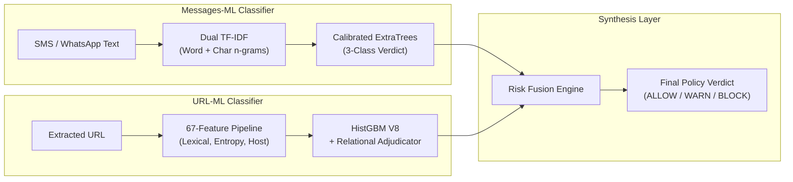

# Sentinel-ML — Machine Learning Security Intelligence

**Sentinel-ML** is the core machine-learning research and evaluation repository for the Sentinel on-device security ecosystem. It provides real-time, privacy-preserving threat intelligence to defend mobile users against smishing, phishing, and malicious URLs without transmitting sensitive message data to cloud servers.

---

## 1. System Overview & Classifiers

Sentinel employs two dedicated offline classifiers whose predictions are unified at the application boundary:



### 1.1 Messages-ML: Three-Class Message Threat Classifier
- **Scope**: Evaluates inbound SMS notifications, WhatsApp messages, and direct chats.
- **Target Taxonomy**:
  - `BENIGN`: Legitimate interpersonal chats, OTP notifications, personal correspondence.
  - `SPAM`: Commercial promotions, unsolicited marketing, non-malicious bulk broadcasts.
  - `MALICIOUS`: Smishing, credential harvesting, lottery scams, banking impersonation, malicious APK lures.
- **Architecture**: Dual TF-IDF representation (word 1–2 n-grams and character 3–5 n-grams) coupled with a calibrated `ExtraTreesClassifier` (Extremely Randomized Trees) ensemble.
- **Champion Artifacts**: [`Messages-ml/champion_model.pkl`](file:///c:/Users/user/Programing%20files/Yajat/Projects/sentinel/sentinel-ml/Messages-ml/champion_model.pkl), [`Messages-ml/champion_v2_model.pkl`](file:///c:/Users/user/Programing%20files/Yajat/Projects/sentinel/sentinel-ml/Messages-ml/champion_v2_model.pkl).

### 1.2 URL-ML: Binary URL Threat Classifier
- **Scope**: Real-time evaluation of hyperlinks extracted from messages or notifications.
- **Target Taxonomy**: Binary classification (`BENIGN` vs `MALICIOUS`).
- **Architecture**: 67-dimensional deterministic feature extraction (`V7_FEATURE_NAMES` ordered alphabetically) fed into a scikit-learn `HistGradientBoostingClassifier` (HistGBM V8, 350 trees) and refined by a deterministic relational adjudication layer.
- **Architectural Clarification**: The URL classifier is a gradient-boosted decision tree ensemble; it is **not** a Small Language Model (SLM) or neural network.
- **Champion Artifacts**: [`URL-ml/models/v8_champion.joblib`](file:///c:/Users/user/Programing%20files/Yajat/Projects/sentinel/sentinel-ml/URL-ml/models/v8_champion.joblib), [`URL-ml/models/v8_champion_portable.json`](file:///c:/Users/user/Programing%20files/Yajat/Projects/sentinel/sentinel-ml/URL-ml/models/v8_champion_portable.json).

---

## 2. Risk Fusion Engine Integration

The individual classifiers are orchestrated at the client application boundary through the **Risk Fusion Engine**, which enforces strict security invariants:

1. **`PAYLOAD OVERRIDES CONTEXT`**:
   A benign message text score (e.g., "Hi friend, take a look at this photo") can **never** suppress an attached dangerous link. If the extracted URL exhibits `severity >= EvidenceSeverity.HIGH`, the overall decision must evaluate to `WARN` or `BLOCK`.
2. **`GROUP != WHITELIST`**:
   Group chat membership (e.g., WhatsApp groups) is never treated as a trusted bypass. Embedded hyperlinks are independently adjudicated regardless of group familiarity.
3. **`BRAND GATING & ACTIVE ATTACK ESCALATION`**:
   Known authentic brand domains suppress false alarms only when zero active threat tokens are detected. If an attack pattern (such as an `.apk` download or credential-stealing path) is present, the alert escalates to `CRITICAL` regardless of parent domain reputation.

---

## 3. Repository Folder Structure

```text
sentinel-ml/
├── .gitignore                          # Git ignore rules for ML development
├── README.md                           # Master Sentinel-ML repository guide
├── GITHUB_PREPARATION_REPORT.md        # Migration and repository readiness report
│
├── URL-ml/                             # URL threat classification subsystem
│   ├── data/                           # Training datasets and feature dumps
│   ├── docs/                           # URL-ML specifications and guide
│   ├── experiments/                    # Isolated evaluation suites & gates
│   ├── models/                         # Frozen champion model (v8_champion.joblib, portable JSON)
│   ├── reports/                        # Audit dossiers and phase reports
│   ├── scripts/                        # Feature extractors, classifiers, exporters
│   └── tests/                          # Automated regression & parity tests
│
├── Messages-ml/                        # Message / SMS threat classification subsystem
│   ├── data/                           # Smishing and benign message corpora
│   ├── model/                          # Checkpoints and candidate models
│   ├── reports/                        # Forensic audits and error analyses
│   ├── scripts/                        # Vectorizers, tokenizers, evaluation runners
│   └── tests/                          # Automated message classification tests
│
├── android-runtime/                    # On-device pure Kotlin runtime bridge
│   ├── golden_test_data/               # Golden cross-language test corpora (golden_urls_v8.json)
│   ├── url/assets/                     # Portable JSON model bundles for mobile
│   ├── messages/assets/                # Portable JSON message assets for mobile
│   └── tools/                          # Generator scripts and validation tools
│
├── shared/                             # Shared contracts and protocol definitions
│   ├── contracts.py                    # Data classes, enums (EvidenceSeverity, DecisionVerdict)
│   └── README.md                       # Shared interfaces documentation
│
├── scripts/                            # Repository verification utilities
│   └── verify_ml_environment.py        # Environment & artifact integrity checker
│
├── docs/                               # Architectural and reference documentation
│   ├── ARCHITECTURE.md                 # Detailed ML subsystem architecture
│   └── MODEL_SPECIFICATIONS.md         # Model catalog, schemas, and distribution guide
│
├── reports/                            # Central index of ML evaluations and audits
│   └── README.md                       # Audit reports directory index
│
├── Databases/                          # Threat forensics SQLite databases (local only)
├── investigation/                      # Forensic recovery tools and DB parsers
├── 7sep_messages_v3/                   # Historical baseline candidates & replay data
├── 6sep/                               # Historical optimization snapshots
├── archive/                            # Historical model & dataset archives
├── New_history/                        # Device message history replay logs
└── scratch/                            # Experimental ablation studies and scratch scripts
```

---

## 4. Development Requirements

- **Python**: `>= 3.10` (Python 3.11 recommended).
- **Core Dependencies**:
  - `numpy >= 1.24.0`
  - `scipy >= 1.10.0`
  - `scikit-learn >= 1.3.0`
  - `joblib >= 1.3.0`
  - `pytest >= 7.4.0` (for running test suites)
- **Virtual Environment Setup**:
  ```bash
  python -m venv venv
  # On Windows:
  .\venv\Scripts\Activate.ps1
  # On Linux/macOS:
  source venv/bin/activate

  pip install numpy scipy scikit-learn joblib pytest
  ```

---

## 5. Running Verification & Inference Scripts

### 5.1 Repository Environment Verification
Run the verification utility to validate your environment and verify frozen champion artifacts without running git or retraining:
```bash
python scripts/verify_ml_environment.py
```

### 5.2 URL Classification Benchmark & Golden Parity
Run the URL parity suite to confirm the HistGBM V8 model and Kotlin portable JSON match expected reference predictions:
```bash
cd URL-ml
python scripts/benchmark_v8.py
pytest tests/
```

### 5.3 Messages Classification Evaluation
Run the Messages-ML evaluation scripts to reproduce forensic metrics:
```bash
cd Messages-ml
python scripts/reproduce_frozen_v43.py
pytest tests/
```

---

## 6. Required Model Files & Distribution Notes

### 6.1 Essential Production Artifacts

| Classifier | Model File | Size | Format | Runtime Consumer |
| :--- | :--- | :--- | :--- | :--- |
| **URL-ML** | `URL-ml/models/v8_champion.joblib` | 1.2 MB | Joblib | Python offline evaluation |
| **URL-ML** | `URL-ml/models/v8_champion_portable.json` | 850 KB | JSON | Android pure-Kotlin evaluator |
| **Messages-ML** | `Messages-ml/champion_model.pkl` | 1.54 MB | Pickle | Python offline evaluation |
| **Messages-ML** | `Messages-ml/champion_tfidf.pkl` | 78 KB | Pickle | Python feature extraction |
| **Messages-ML** | `android-runtime/messages/assets/champion_v2_*.json` | ~1.2 MB | JSON | Android pure-Kotlin evaluator |

### 6.2 Distribution Policy
- **Local Preservation**: All trained model files and checkpoints are preserved locally on disk.
- **Git Tracking**: Portable JSON model bundles (`*_portable.json`, `champion_v2_*.json`) are text-based and tracked directly by Git.
- **Binary Releases**: Heavy binary formats (`*.joblib`, `*.pkl`) are excluded from git commits by `.gitignore` to prevent repository bloat and mitigate arbitrary code execution risks from deserializing untrusted pickling formats. For competition replication, binary weights can be distributed via authenticated GitHub Releases with verified SHA-256 checksums.

---

## 7. Current Limitations & Development Status

1. **Non-SLM Architecture**: Both URL-ML and Messages-ML utilize classical, lightweight tree ensembles (HistGradientBoosting and ExtraTrees). They are engineered for sub-millisecond, low-memory on-device execution rather than generative tasks.
2. **Performance & Gate Verification**: In empirical testing, models demonstrate high detection capability on clean benchmark splits; however, synthetic stress probes indicate edge-case sensitivity (e.g. conversational false alerts on benign messages containing non-resolving testing domains). No claim is made that models achieve $\ge 80\%$ accuracy across every conceivable category without continuous threshold tuning.
3. **Ongoing Data Localization**: Messages-ML is undergoing active multi-source curation (Messages V5 sprint) to expand coverage of Indian regional languages, Hinglish phrasing, and multi-lingual transactional notification templates.
4. **Offline Mobile Parity**: Pure Kotlin tree traversal eliminates runtime dependencies on TensorFlow or ONNX on Android endpoints, delivering verified float-precision parity against Python models.
