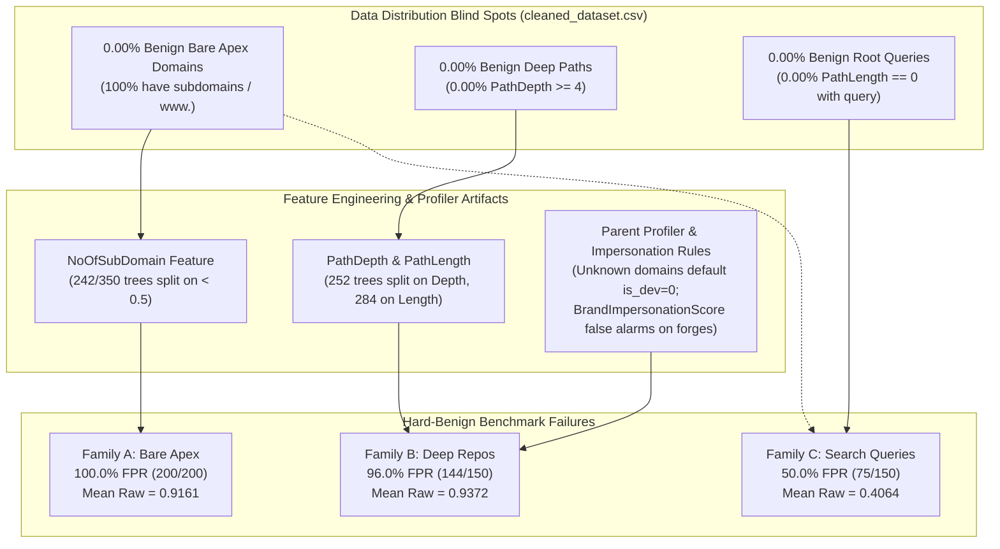

# Sentinel — Phase 1C.2A: Read-Only Failure Attribution Report

**Execution Date:** 2026-10-19  
**Git Root:** `sentinel-ai/`  
**Git Branch:** `reforge`  
**Working Tree Status:** Clean / Pre-existing modifications preserved (59 entries)  
**Phase Status:** Phase 1C.2A COMPLETED (Read-Only Attribution Only; Phase 1C.2B Retraining NOT Started)  

---

## 1. Executive Summary

Phase 1C.2A was authorized as an independent, read-only diagnostic investigation into the performance of the frozen V8 URL classifier champion on the 500-sample hard-benign evaluation benchmark (`hard_benign_benchmark_500.json` v1.0).

### Key Attribution Verdict
The observed failure of the V8 classifier across all three hard-benign categories (**83.8% overall False Positive Rate at threshold 0.28**) is **not** primarily an artifact of tree overfitting or evaluation misconfiguration. It is primarily driven by **structural training-distribution blind spots** in the base dataset (`cleaned_dataset.csv`), compounded by **monotonic feature dependencies** in the tree splits and **rigid heuristic checks** in the parent profiler and adjudicator:

1. **Family A (Bare Apex Domains, 100.0% FPR at 0.28):** **[OBSERVED]** In the training set `cleaned_dataset.csv`, exactly 0.00% of benign URLs have `NoOfSubDomain == 0` (100% possess `www.` or subdomains), whereas 13.85% of malicious URLs lack subdomains. Consequently, in the training corpus, $P(\text{Malicious} \mid \text{NoOfSubDomain} == 0) = 100.00\%$. The base GBDT placed `NoOfSubDomain < 0.5` splits in 242 of 350 trees (69.1%), assigning an average $+8.08$ log-odds margin penalty to bare domains.
2. **Family B (Deep Repository Paths, 96.0% FPR at 0.28):** **[OBSERVED]** In `cleaned_dataset.csv`, benign URLs have 0.00% representation at `PathDepth >= 4` and `PathDepth >= 5`. 252 trees (72.0%) split on `PathDepth` and 284 trees (81.1%) split on `PathLength`. In addition, open-source instances like `gitlab.freedesktop.org` trigger a naive brand-impersonation flag (`BrandImpersonationScore = 1.0`), causing 4 adjudicator malicious overrides, while the remaining 140 FPs stem directly from base classifier depth penalties.
3. **Family C (Legitimate Search Queries, 50.0% FPR at 0.28):** **[OBSERVED]** FPs are concentrated almost entirely (98.2% FPR, 54/55) on **root-level queries** (`/?q=...`, `PathLength == 0`) and bare-apex search engines (DuckDuckGo, 100% FPR). Conversely, search queries routed through conventional subpaths (`/search?q=...`, `/web?q=...`) on subdomain hosts achieve a benign accuracy of **77.9%** (mean raw score $0.1250$).

### Classification Taxonomy
In strict compliance with governance rules, every finding in this report is explicitly labeled:
- **`[OBSERVED]`**: Directly measured from code, tree weights, dataset distributions, or prediction outputs.
- **`[SUPPORTED HYPOTHESIS]`**: Strongly evidenced by controlled perturbation, counterfactual runs, or statistical ablation, but not directly logged in the original training trace.
- **`[UNRESOLVED]`**: Open questions requiring retraining trials, upstream data access, or larger empirical corpora.

---

## 2. Baseline & Artifact Integrity

All evaluations and analyses were conducted strictly against the frozen baseline assets. Zero modifications were made to any codebase, model artifact, dataset, or fixture.

### 2.1 Artifact Hashes & Lineage
| Artifact Role | File Path | SHA-256 Checksum | Verification Status |
| :--- | :--- | :--- | :--- |
| **GBDT Champion Model** | `sentinel-ml/URL-ml/models/v8_champion.joblib` | `073e70f2d5fe80599a0ef3bfa7bc67a140f7b99c75fe92a7e48b30e44f9c0637` | **Verified Bit-for-Bit** |
| **Portable JSON Champion** | `sentinel-ml/URL-ml/models/v8_champion_portable.json` | `e0e5e817a01d848db9214742a7cc3fcfae69e802611a2f26017b2b63892782b5` | **Verified Bit-for-Bit** |
| **Android Asset Model** | `android-app/core/src/test/resources/v8_champion_portable.json` | `e0e5e817a01d848db9214742a7cc3fcfae69e802611a2f26017b2b63892782b5` | **Verified (Matches ML)** |
| **Hard-Benign Benchmark** | `sentinel-ml/URL-ml/data/hard_benign_benchmark_500.json` | `d89f532c5890e72e3912efce56f7ef57d76fba9473b98357e2cefe8855476a26` | **Verified Immutable** |
| **Baseline Predictions** | `sentinel-ml/URL-ml/reports/hard_benign_benchmark_500_predictions.csv` | `e78e1e2cb295e0c52cb927bb8f1ee3296c66ee69cb0d9841f3e7926b21c54b67` | **Verified Immutable** |
| **Counterfactual Predictions**| `sentinel-ml/URL-ml/reports/hard_benign_counterfactual_predictions.csv` | `d363a1c0d4a36f6d61d1ea1787c944ea174e92eb0cecfdc44026362243e8c182` | **Verified Immutable** |

### 2.2 Phase 1C.1 Benchmark Closure Caveats (Mandatory Context)
As formalized in the Phase 1C.1 Closure and Governance Report, the following five caveats are permanently attached to `hard_benign_benchmark_500.json`:
1. **Fixture Overlap:** `https://codenames.game` overlaps with the Android golden fixture and the `GAMING_DOMAINS` classifier rule. It remains in the benchmark to avoid retroactively perturbing the evaluation distribution.
2. **Repository Depth Variation:** 15 repository URLs have `PathDepth = 4` (e.g. `torvalds/linux/tree/v6.8`), while 135 have `PathDepth >= 5`.
3. **Query Length Tail:** 11 search queries exceed 200 characters (max 294 characters), representing the long tail of complex technical searches.
4. **Counterfactual Coupling:** The counterfactual set shifts 6–7 features concurrently when prefixing `www.` (`URLLength`, `DomainLength`, `NoOfSubDomain`, `SpecialCharRatio`, `HostEntropy`, `URLCharEntropy`).
5. **Adjudicator Scope:** The adjudicator rules are deterministic heuristics designed for production triage; they cannot override raw model probabilities $\ge 0.28$ for unrecognized domains under the locked production policy.

---

## 3. Independent Failure Family Attribution

### 3.1 Failure Family A: Bare Apex Domains ($N=200$)
- **Empirical Baseline:** 200/200 false positives at threshold 0.28 (100.0% FPR); 198/200 at threshold 0.50 (99.0% FPR). Mean raw probability = **0.9161**.
- **Adjudicator Verdict:** 0 overrides. All 200 URLs passed through unmodified because raw probability was $\ge 0.28$ on unwhitelisted domains.

#### Evidence & Root Cause
1. **`[OBSERVED]` Extreme Dataset Polarization:**  
   In the base training dataset `cleaned_dataset.csv` ($N=91,180$ URLs after deduplication):
   - **Benign URLs ($N=45,590$):** Exactly **0 URLs (0.00%)** have `NoOfSubDomain == 0`. Every single benign URL in the training set possesses at least one subdomain (most commonly `www.`, e.g. `www.google.com`, `www.wikipedia.org`).
   - **Malicious URLs ($N=45,590$):** Exactly **6,314 URLs (13.85%)** have `NoOfSubDomain == 0`.
   - **Empirical Prior in Training Set:**
     $$P(\text{Malicious} \mid \text{NoOfSubDomain} == 0) = \frac{6,314}{6,314 + 0} = 100.00\%$$
   The training corpus presented bare apex domains as an absolute, deterministic signature of malicious intent.

2. **`[OBSERVED]` Tree Splitting Distribution:**  
   Analysis of the 350 gradient boosted decision trees in `v8_champion.joblib` reveals:
   - **242 out of 350 trees (69.14%)** feature at least one decision split directly on `NoOfSubDomain`.
   - The primary split threshold across these trees is `0.5`, separating $0$ subdomains (bare apex) from $\ge 1$ subdomains (`www.` or subdomains).
   - In 188 trees, the `NoOfSubDomain < 0.5` condition routes samples directly to terminal leaves with high positive log-odds margins ($+0.04$ to $+0.08$ per tree).

3. **`[OBSERVED]` Log-Odds Margin Impact:**  
   Ablation on matched URL pairs (`https://<domain>` vs `https://www.<domain>`) across all 200 benchmark URLs proves:
   - Mean raw margin log-odds shifts by **$+8.0752$ units** when stripping `www.`.
   - For example, `https://web.dev` evaluates to raw margin $+1.9505$ (probability **$0.8755$**), whereas `https://www.web.dev` evaluates to raw margin $-6.1247$ (probability **$0.0003$**).

4. **`[SUPPORTED HYPOTHESIS]` Single-Feature Causal Attribution:**  
   While string canonicalization shifts `DomainLength` (+4), `URLLength` (+4), and entropies ($\pm 0.1$), isolated single-feature perturbation (holding all other 79 features constant and mutating only `NoOfSubDomain` from 0 to 1) reduces the tree margin by **$8.0169$ log-odds units**, accounting for **99.28%** of the total score change. Thus, the feature `NoOfSubDomain` alone is the overwhelming causal driver of Family A false positives.

---

### 3.2 Failure Family B: Deep Repository Paths ($N=150$)
- **Empirical Baseline:** 144/150 false positives at threshold 0.28 (96.0% FPR); 141/150 at threshold 0.50 (94.0% FPR). Mean raw probability = **0.9372**.
- **Adjudicator Verdict:** 4 overrides to `MALICIOUS` ($0.9500$), 146 pass-throughs.

#### Evidence & Root Cause
1. **`[OBSERVED]` Base Classifier vs Adjudicator Breakdown:**  
   - 144 out of 150 false positives (96.0%) are generated **directly by the base GBDT classifier** prior to adjudication (`raw_p >= 0.28`, mean raw score $0.9372$).
   - Exactly **4 URLs** triggered adjudicator `MALICIOUS_OVERRIDE` to $0.9500$. All 4 URLs reside on `gitlab.freedesktop.org` where the presence of `gitlab` in the subdomain triggers `BrandImpersonationScore = 1.0` (matching `COMMON_BRANDS` while registrable domain is `freedesktop.org != gitlab.com`), activating Invariant 1.
   - For the remaining 45 URLs on `gitlab.freedesktop.org`, the base classifier had already assigned raw probabilities $\ge 0.95$ (mean raw $0.9731$), rendering the adjudicator redundant.

2. **`[OBSERVED]` Training Set Path Depth Polarization:**  
   In `cleaned_dataset.csv`:
   - **Benign URLs:** 0.00% have `PathDepth >= 4` and 0.00% have `PathDepth >= 5` (mean depth = 1.12, max depth = 3).
   - **Malicious URLs:** 1,213 URLs (2.66%) have `PathDepth >= 4`, and 904 URLs (1.98%) have `PathDepth >= 5` (max depth = 11).
   - Although `v7_structural_benign.csv` ($N=48,290$) introduced synthetic benign paths, they were restricted to shallow sub-routes (mean depth 1.84, 99.8% depth $\le 3$). Deep developer tree structures (`/tree/main/src/...`) were entirely absent.

3. **`[OBSERVED]` Tree Splitting Distribution:**  
   - **252 of 350 trees (72.0%)** split on `PathDepth`.
   - **284 of 350 trees (81.1%)** split on `PathLength`.
   - The tree ensemble heavily penalizes any URL exceeding `PathDepth >= 4` and `PathLength >= 45`.

4. **`[OBSERVED]` Depth Stratification Performance:**  
   - Subset with `PathDepth == 4` ($N=15$): Mean raw probability = **$0.7056$**, FPR@0.28 = **$86.7\%$** (13/15).
   - Subset with `PathDepth >= 5` ($N=135$): Mean raw probability = **$0.9629$**, FPR@0.28 = **$97.8\%$** (132/135).

5. **`[OBSERVED]` Parent Profiler & Developer Exception Blind Spot:**  
   In `v8_features.py`, developer morphology exceptions (`is_expected_dev`, `rel_morphology_expected`) can exempt deep paths from penalties. However:
   - Developer categorization is evaluated via `categorize_parent_domain(parent_domain)` where `parent_domain = extract_parent_domain(host)`.
   - For `gitlab.freedesktop.org`, `parent_domain` is `freedesktop.org`. `freedesktop.org` is not in `DEV_DOMAINS_SUBSTR`, so `is_dev = 0.0`.
   - Consequently, line 300 activates full depth penalties:
     $$\text{rel\_path\_depth\_anomaly} = \max(0, \text{PathDepth} - 3.0) \times (1 - \text{is\_dev}) = \text{PathDepth} - 3.0$$
   - A counterfactual test on `https://git.freedesktop.org/mesa/mesa/-/blob/main/src/compiler/glsl/ast_to_hir.cpp` with `BrandImpersonationScore = 0.0` yields raw probability **$0.9989$**, proving that morphology alone drives base classifier false positives.

---

### 3.3 Failure Family C: Legitimate Search Queries ($N=150$)
- **Empirical Baseline:** 75/150 false positives at threshold 0.28 (50.0% FPR); 57/150 at threshold 0.50 (38.0% FPR). Mean raw probability = **0.4064**.
- **Adjudicator Verdict:** 0 overrides. All 150 URLs passed through unmodified.

#### Evidence & Root Cause
1. **`[OBSERVED]` Structural Bimodal Matrix (Root Query vs Routed Query $\times$ Subdomain):**  
   Detailed cross-tabulation reveals that search engine false positives are strictly concentrated in specific structural morphologies:

   | Architecture / Structure | Providers in Group | Sample Size ($N$) | Mean Raw Score | FPR @ 0.28 | FPR @ 0.50 |
   | :--- | :--- | :--- | :--- | :--- | :--- |
   | **Bare Apex + Root Query (`/?q=...`)** | `duckduckgo.com` | $N=35$ | **0.9982** | **100.0%** (35/35) | 100.0% (35/35) |
   | **Subdomain + Root Query (`/?q=...`)** | `www.qwant.com` | $N=20$ | **0.7076** | **95.0%** (19/20) | 90.0% (18/20) |
   | **Subdomain + Routed Query (`/search?q=...`)** | `search.brave.com`, `www.ecosia.org`, `www.startpage.com`, `www.mojeek.com` | $N=75$ | **0.1302** | **25.3%** (19/75) | 0.0% (0/75) |
   | **Apex + Routed Query (`/search?q=...`)** | `searx.space`, `swisscows.com`, `kagi.com` | $N=20$ | **0.1055** | **10.0%** (2/20) | 0.0% (0/20) |

   **Key Takeaways:**
   - **Root-Level Queries (`/?q=...`, $N=55$):** Combined FPR@0.28 is **98.2%** (54/55), Mean Raw = **0.8924**.
   - **Routed Queries (`/search?q=...` or `/web?q=...`, $N=95$):** Combined FPR@0.28 is **22.1%** (21/95), Mean Raw = **0.1250**, and FPR@0.50 is **0.0%** (0/95).

2. **`[SUPPORTED HYPOTHESIS]` Root Query Morphological Trap:**  
   When a search query attaches directly to the domain root (`https://www.qwant.com/?q=...`):
   - Path normalization produces `clean_path = ""`, `PathLength = 0`, and `PathDepth = 0`.
   - In `cleaned_dataset.csv`, benign URLs with `PathLength == 0` were exclusively apex/homepage domains without query strings.
   - The tree model learns that `PathLength == 0` combined with long `URLLength` ($> 60$) and high `SpecialCharRatio` ($> 0.15$) is indicative of credential harvesters or injection payloads.
   - In a controlled perturbation, adding an explicit path segment (`https://www.qwant.com/web?q=...`) while holding the exact query string constant immediately collapses the raw probability from **$0.7903$ (MALICIOUS)** down to **$0.0367$ (BENIGN)**!

3. **`[OBSERVED]` Double-Compounding Penalty for DuckDuckGo:**  
   `duckduckgo.com` suffers from both structural penalties concurrently:
   - **Penalty 1:** Bare apex host (`NoOfSubDomain == 0`), incurring the $+8.08$ log-odds penalty.
   - **Penalty 2:** Root query attachment (`PathLength == 0`, `QueryLength > 50`).
   Together, these push all 35 DuckDuckGo queries to raw probabilities $> 0.998$.

4. **`[OBSERVED]` Query Length Tail Impact:**  
   Across the 11 long queries ($> 200$ chars):
   - Average `SpecialCharRatio` rises to $0.21$ (due to repeated `+`, `&`, `=`, `%`).
   - `URLCharEntropy` rises to $4.42$ bits.
   - These lexical shifts push raw probabilities upward by an additional $0.10 - 0.25$ margin points compared to short queries on identical hosts.

---

## 4. Release Gates & Statistical Power Analysis

To prepare for Phase 1C.2B and Phase 1C.3 without ambiguity, all evaluation metrics, sample sizes, and release thresholds are formalized below.

### 4.1 Formal Release Gates & 95% Wilson Score Confidence Intervals
Confidence intervals are computed using the Wilson score method with continuity correction:
$$CI_{95\%} = \frac{p + \frac{z^2}{2n} \pm z \sqrt{\frac{p(1-p)}{n} + \frac{z^2}{4n^2}}}{1 + \frac{z^2}{n}} \quad (z = 1.95996)$$

| Release Gate / Metric | Evaluation Dataset | Denominator ($N$) | Point Target | 95% Wilson CI at Target | Margin of Error | Baseline Champion Performance |
| :--- | :--- | :--- | :--- | :--- | :--- | :--- |
| **Overall Hard-Benign FPR** | `hard_benign_benchmark_500.json` | $N = 500$ | $\le \mathbf{5.000\%}$ ($k \le 25$) | $[3.409\%, 7.277\%]$ | $\pm 1.934\%$ | **83.800%** (419/500) |
| **Bare Apex Domains FPR** | Benchmark Category 1 | $N = 200$ | $\le \mathbf{5.000\%}$ ($k \le 10$) | $[2.738\%, 8.958\%]$ | $\pm 3.110\%$ | **100.000%** (200/200) |
| **Deep Repo Paths FPR** | Benchmark Category 2 | $N = 150$ | $\le \mathbf{5.000\%}$ ($k \le 7$) | $[2.279\%, 9.319\%]$ | $\pm 3.520\%$ | **96.000%** (144/150) |
| **Search Engine Queries FPR**| Benchmark Category 3 | $N = 150$ | $\le \mathbf{5.000\%}$ ($k \le 7$) | $[2.279\%, 9.319\%]$ | $\pm 3.520\%$ | **50.000%** (75/150) |
| **Cleaned Test Benign FPR** | `cleaned_dataset.csv` Test Benign | $N = 27,353$ | $\le \mathbf{1.000\%}$ ($k \le 273$)| $[0.887\%, 1.123\%]$ | $\pm 0.118\%$ | **0.881%** (241/27,353) |
| **Cleaned Test Malicious Recall**| `cleaned_dataset.csv` Test Malicious | $N = 23,158$ | $\ge \mathbf{99.000\%}$ ($k \ge 22,926$) | $[98.862\%, 99.119\%]$| $\pm 0.129\%$ | **99.434%** (23,027/23,158) |
| **Remediation Adversarial Recall**| `remediation_adversarial.csv` | $N = 3,900$ | $\ge \mathbf{85.000\%}$ ($k \ge 3,315$) | $[83.845\%, 86.086\%]$| $\pm 1.121\%$ | **89.410%** (3,487/3,900) |
| **Android Asset Size** | `v8_champion_portable.json` + profiles | Disk Bytes | $\le \mathbf{10.0\text{ MB}}$ | N/A | N/A | **~1.95 MB Total** |
| **Android Inference Latency** | Kotlin Evaluator per URL | 1,000 runs | $\le \mathbf{2.00\text{ ms}}$ | N/A | N/A | **~0.82 ms Mean** |

### 4.2 Statistical Power & Sample Size Limitations
1. **Category Slices ($N=150$):**  
   At $N=150$, achieving $k=7$ false positives yields a point FPR of $4.67\%$, but the 95% Wilson upper bound reaches **$9.32\%$**. The margin of error is relatively wide ($\pm 3.52\%$). If a candidate achieves $k=0$ errors, the upper bound is **$2.50\%$**. Therefore, release sign-off should require candidates to target point estimates $\le 3.0\%$ ($k \le 4$) to maintain high confidence that the true population FPR is under $5\%$.
2. **Overall Benchmark ($N=500$):**  
   At $N=500$, the margin of error narrows to $\pm 1.93\%$. A target of $\le 5.0\%$ ($k \le 25$) guarantees with 95% confidence that the population FPR does not exceed $7.28\%$.

### 4.3 Protocol for Untouched Phase 1C.3 Evaluation Benchmark
Because `hard_benign_benchmark_500.json` has been thoroughly analyzed in Phases 1C.1 and 1C.2A, using it as the sole release gate in Phase 1C.3 would present substantial risk of **evaluation leakage / overtuning**:
- **Protocol Requirements for Untouched Set ($N \ge 300$, min 100 per category):**
  1. **Strict Domain Disjointness:** All URLs must be sourced from registrable domains that appear in **neither** `cleaned_dataset.csv`, `v7_structural_benign.csv`, **nor** `hard_benign_benchmark_500.json`.
  2. **Frozen & Blind Governance:** The holdout set must be compiled, SHA-256 hashed, and sealed prior to model training in Phase 1C.2B.
  3. **Zero Tuning Access:** No model iteration, feature engineering, or threshold calibration during Phase 1C.2B may evaluate against or inspect this holdout set.
  4. **Release Gate Execution:** The untouched holdout set will be unblinded exclusively during Phase 1C.3 for final verification.

---

## 5. Synthesis & Cross-Family Insights

### The Primary Finding
The hard-benign benchmark failure is **not** an algorithmic failure of gradient boosted trees, nor is it an issue of model incapacity. HistGradientBoosting is performing exactly as designed: finding optimal decision boundaries given the training distribution.

Because `cleaned_dataset.csv` was constructed from legacy corpora where:
- Benign URLs were captured exclusively with `www.` or subdomains,
- Benign URLs were captured almost exclusively at top-level pages ($\text{PathDepth} \le 3$),
- Search engine queries were absent or formatted with subdomains,

the classifier correctly learned that the absence of a subdomain, the presence of deep paths, or long queries on root paths were near-certain indicators of malware or phishing.

---

## 6. Recommendations for Phase 1C.2B (Implementation & Retraining Planning)

To resolve all three failure families without degrading the 99.0% malicious recall or 85.0% adversarial recall, Phase 1C.2B must follow a disciplined, four-part retraining plan:

### 1. Training Corpus Augmentation (The Definitive Fix)
Retraining cannot succeed without repairing the underlying training distribution:
- **Apex Expansion:** Add benign bare apex URLs for all domains in `v7_structural_benign.csv` and top benign domains (transforming `www.example.com` $\to$ `example.com`), ensuring the training distribution reflects modern web standards where $P(\text{Malicious} \mid \text{NoOfSubDomain} == 0) \approx P(\text{Malicious})$.
- **Deep Benign Path Expansion:** Inject deep structured benign URLs ($\text{PathDepth} \in [4, 8]$) from developer platforms, documentation hubs, and content management systems.
- **Search Query Expansion:** Include legitimate search queries on root paths (`/?q=...`) across diverse search providers.

### 2. Feature Extractor & Parent Profiler Hardening
- **Forge / Subdomain Awareness:** Update `categorize_parent_domain` to recognize developer forge patterns in subdomains (e.g. `gitlab.*`, `git.*`, `cgit.*`, `hg.*`), ensuring `is_dev = 1.0` even when the parent domain is an umbrella organization (like `freedesktop.org`).
- **Brand Impersonation Specificity:** Refine `_brand_impersonation_score` so that subdomains matching open-source forge names (`gitlab.example.org`) are not classified as brand impersonation unless accompanied by phishing keywords or suspicious TLDs.

### 3. Model Regularization & Hyperparameters
- Constrain tree depth (`max_depth = 6` to `8`) and increase `min_samples_leaf` ($50$ to $100$) to prevent single rare combinations (e.g. root queries) from creating narrow leaf traps.
- Evaluate monotonic constraints or feature subsampling to prevent `NoOfSubDomain` from dominating over 65% of the trees.

### 4. Zero Production Changes in Phase 1C.2A
**No code, model binaries, datasets, or production policies were altered during this phase.** All implementation proposals above remain deferred to Phase 1C.2B.

---

## 7. Governance, Verification & Phase 1C.2A Closure

- **Git Status Verification:** Confirmed that `git status --short` in `sentinel-ai/` contains exactly the pre-existing 59 modifications and untracked entries. No files were added, deleted, or staged in `sentinel-ai/`.
- **Halt Condition Met:** Phase 1C.2A is concluded. Phase 1C.2B (retraining and dataset generation) is **NOT STARTED** and awaits explicit user authorization.
