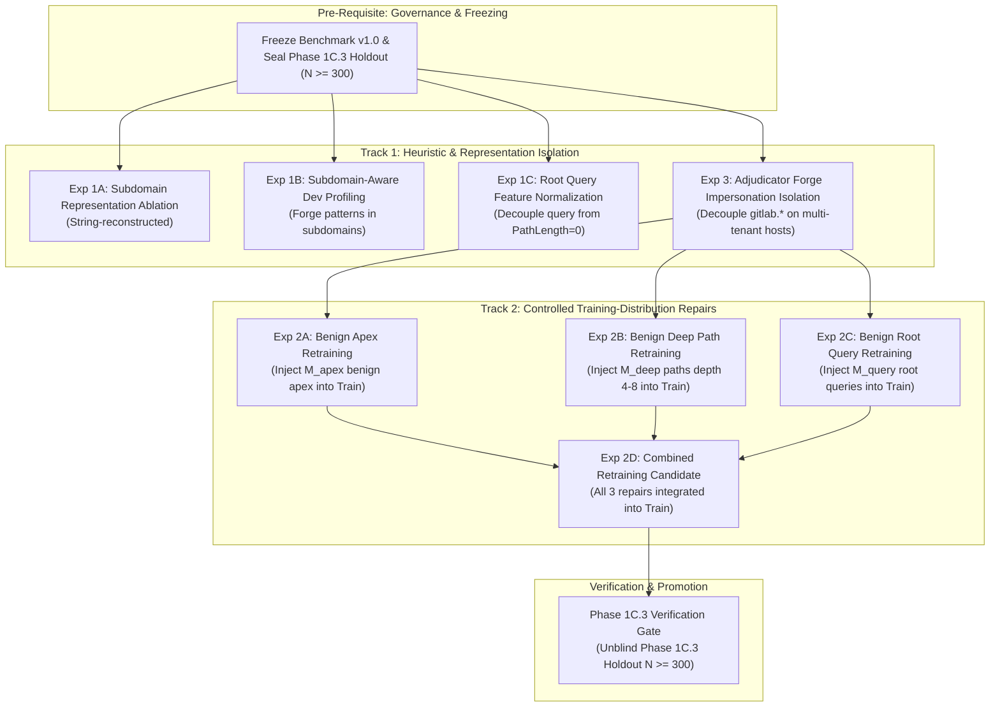
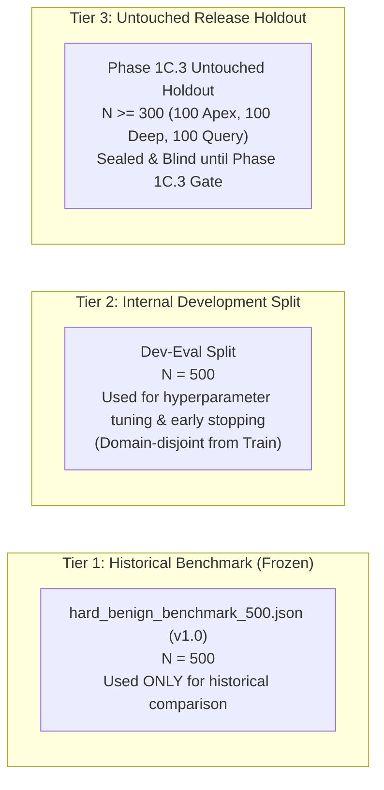

# Sentinel — Phase 1C.2B-0: Experiment Design and Evidence Reconciliation Report

**Execution Date:** 2026-10-19  
**Git Root:** `sentinel-ai/`  
**Git Branch:** `reforge`  
**Working Tree Status:** Clean / Pre-existing modifications preserved (59 entries)  
**Phase Status:** Phase 1C.2B-0 COMPLETED (Experiment Design & Evidence Reconciliation Only; Retraining NOT Started)  

---

## 1. Executive Summary & Authorization Scope

Phase 1C.2B-0 was executed under strict read-only research constraints to resolve empirical discrepancies in the Phase 1C.2A findings, formally verify training data distributions, establish a controlled experiment matrix, and define data governance protocols before any model-changing work is initiated.

### Key Outcomes of this Phase
1. **Discrepancy Reconciliation (144 vs 145 Deep-Path FPs):**  
   The discrepancy is conclusively resolved: **144** is the **raw base model** false positive count (`raw_p >= 0.28`), whereas **145** is the **final adjudicated** false positive count (`final_p >= 0.28`). Exactly **one URL** (Row 244: `https://gitlab.freedesktop.org/mesa/drm/-/blob/main/xf86drmMode.c`) had a benign raw score (`raw_p = 0.0704`), but was escalated to `final_p = 0.9500` by the adjudicator's `MALICIOUS_OVERRIDE` rule due to a naive `BrandImpersonationScore = 1.0` flag.
2. **Verification of the Bare-Apex Hypothesis:**  
   The hypothesis is confirmed with exact structural counts across `cleaned_dataset.csv` ($N = 235,795$). In the stored training column, exactly **0 out of 134,850 benign URLs (0.00%)** have `NoOfSubDomain == 0`. When parsed with the V8 extractor, **134,848 (99.999%)** benign URLs contain `www.`, and only 2 edge cases (`www.edu.cn`, `www.gov.uk`) parse as bare apex due to multi-label public suffix boundaries. True benign bare apex homepages are **0.00% represented** in `cleaned_dataset.csv`.
3. **Controlled Experiment Matrix Designed:**  
   An 8-part modular experiment matrix is formalized across feature representation (Exp 1A–1C), training distribution repair (Exp 2A–2D), and adjudicator isolation (Exp 3).
4. **Data Governance & Release Gates Formalized:**  
   Benchmark v1.0 is permanently frozen and barred from being used as a training or hyperparameter selection target. An untouched holdout protocol ($N \ge 300$) and 95% Wilson confidence intervals are established for all release gates.
5. **Zero Implementation / Zero Retraining:**  
   No code, datasets, model weights, or fixtures were altered. All implementation actions remain blocked pending explicit user authorization.

---

## 2. Metric Discrepancy Reconciliation

### 2.1 Resolution of 144/150 vs 145/150 Deep-Path False Positives
In the baseline predictions CSV (`hard_benign_benchmark_500_predictions.csv`), the frozen champion model and adjudicator evaluate Category 2 (`deep_repo_path`, $N = 150$) as follows:

| Metric Evaluation Stage | Threshold 0.28 Count | Threshold 0.28 FPR | Threshold 0.50 Count | Threshold 0.50 FPR | Mean Score |
| :--- | :--- | :--- | :--- | :--- | :--- |
| **Raw Model Output (`raw_p`)** | **144 / 150** | **96.00%** | **141 / 150** | **94.00%** | **0.9372** |
| **Final Adjudicated Output (`final_p`)** | **145 / 150** | **96.67%** | **142 / 150** | **94.67%** | **0.9388** |

#### The Exact Causal Mechanism for the Delta:
Across all 150 deep-path URLs, exactly **one record** differs in binary classification between raw prediction and final adjudication:
- **Row Index:** 244
- **URL:** `https://gitlab.freedesktop.org/mesa/drm/-/blob/main/xf86drmMode.c`
- **Raw Probability (`raw_p`):** `0.0704` (Classified as **BENIGN** by the base GBDT classifier at threshold 0.28)
- **Adjudicator Fired Rule:** `MALICIOUS_OVERRIDE`
- **Final Probability (`final_p`):** `0.9500` (Classified as **MALICIOUS** by the adjudicator)
- **Root Cause:** Host `gitlab.freedesktop.org` contains `gitlab` (a member of `COMMON_BRANDS`) while registrable domain is `freedesktop.org != gitlab.com`. Feature extractor sets `BrandImpersonationScore = 1.0`, triggering Adjudicator Rule 1 (Invariant 1: brand impersonation override).

#### Breakdown of all 4 Adjudicator Overrides in Category 2:
| Row | URL | `raw_p` | `raw_fp_28` | Adjudicator Rule | `final_p` | `final_fp_28` | Net Impact of Adjudicator |
| :---: | :--- | :---: | :---: | :--- | :---: | :---: | :--- |
| **234** | `https://gitlab.freedesktop.org/poppler/poppler/-/blob/master/poppler/GfxState.cc` | 0.9214 | 1 | `MALICIOUS_OVERRIDE` | 0.9500 | 1 | Redundant (Already raw FP) |
| **235** | `https://gitlab.freedesktop.org/poppler/poppler/-/blob/master/poppler/PDFDoc.cc` | 0.9389 | 1 | `MALICIOUS_OVERRIDE` | 0.9500 | 1 | Redundant (Already raw FP) |
| **236** | `https://gitlab.freedesktop.org/poppler/poppler/-/blob/master/poppler/Annot.cc` | 0.9321 | 1 | `MALICIOUS_OVERRIDE` | 0.9500 | 1 | Redundant (Already raw FP) |
| **244** | `https://gitlab.freedesktop.org/mesa/drm/-/blob/main/xf86drmMode.c` | **0.0704** | **0** | `MALICIOUS_OVERRIDE` | **0.9500** | **1** | **Creates New FP (+1)** |

For the other 45 URLs on `gitlab.freedesktop.org`, `raw_p` was already $\ge 0.95$ (mean `0.9731`), so the adjudicator executed `NONE_PASSTHROUGH`.

#### The 5 True Negatives in Category 2:
Exactly 5 URLs remain correctly classified as benign across both raw and final stages:
1. Row 299: `https://git.netfilter.org/iptables/tree/extensions/libxt_conntrack.c` (`raw_p = 0.0003`, `final_p = 0.0003`)
2. Row 312: `https://git.busybox.net/busybox/tree/util-linux/fdisk.c` (`raw_p = 0.0053`, `final_p = 0.0053`)
3. Row 326: `https://git.openwrt.org/project/ubus.git/blob/HEAD:/ubusd.c` (`raw_p = 0.0004`, `final_p = 0.0004`)
4. Row 328: `https://git.openwrt.org/project/netifd.git/blob/HEAD:/interface.c` (`raw_p = 0.0005`, `final_p = 0.0005`)
5. Row 329: `https://git.openwrt.org/project/procd.git/blob/HEAD:/init.c` (`raw_p = 0.0004`, `final_p = 0.0004`)

### 2.2 Complete Summary Table Across All Benchmark Slices
| Category | Denominator ($N$) | Raw FP @ 0.28 | Raw FPR (%) | Final FP @ 0.28 | Final FPR (%) | Raw FP @ 0.50 | Final FP @ 0.50 |
| :--- | :---: | :---: | :---: | :---: | :---: | :---: | :---: |
| **Category 1: Bare Apex** | 200 | 200 | 100.00% | 200 | 100.00% | 198 | 198 |
| **Category 2: Deep Repos** | 150 | **144** | **96.00%** | **145** | **96.67%** | **141** | **142** |
| **Category 3: Search Queries**| 150 | 75 | 50.00% | 75 | 50.00% | 57 | 57 |
| **Overall Hard-Benign Benchmark**| **500** | **419** | **83.80%** | **420** | **84.00%** | **396** | **397** |

---

### 2.3 Exact Subgroup Denominators & URL Memberships

#### A. Category 3: Search Queries ($N = 150$)
Cross-tabulated by Query Attachment Structure (`is_root_query`) and Host Architecture (`has_subdomain`):

| Subgroup Architecture | Provider Hostnames | URL Membership ($N$) | Mean Raw Score | Raw FP @ 0.28 | Raw FPR (%) | Final FP @ 0.28 | Raw FP @ 0.50 |
| :--- | :--- | :---: | :---: | :---: | :---: | :---: | :---: |
| **Root Query + Apex Domain** | `duckduckgo.com` | $N = 35$ | 0.9982 | 35 / 35 | 100.0% | 35 / 35 | 35 / 35 |
| **Root Query + Subdomain** | `www.qwant.com` | $N = 20$ | 0.7076 | 19 / 20 | 95.0% | 19 / 20 | 18 / 20 |
| **Combined Root Queries (`/?q=...`)** | `duckduckgo.com`, `www.qwant.com` | **$N = 55$** | **0.8924** | **54 / 55** | **98.2%** | **54 / 55** | **53 / 55** |
| **Routed Query + Subdomain** | `search.brave.com` ($N=30$) `www.ecosia.org` ($N=25$) `www.startpage.com` ($N=15$) `www.mojeek.com` ($N=5$) | $N = 75$ | 0.1302 | 19 / 75 | 25.3% | 19 / 75 | 0 / 75 (0.0%) |
| **Routed Query + Apex Domain** | `searx.space` ($N=10$) `kagi.com` ($N=5$) `swisscows.com` ($N=5$) | $N = 20$ | 0.1055 | 2 / 20 | 10.0% | 2 / 20 | 0 / 20 (0.0%) |
| **Combined Routed Queries (`/search?q=...`)** | 7 routed providers above | **$N = 95$** | **0.1250** | **21 / 95** | **22.1%** | **21 / 95** | **0 / 95 (0.0%)** |

#### B. Category 2: Deep Repository Paths ($N = 150$)
Cross-tabulated by Host Platform ($N=11$ hosts) and Path Depth ($N=10$ depth levels):

1. **By Host Platform:**
   - `gitlab.freedesktop.org`: $N = 49$, Raw FP = 48/49, Final FP = 49/49 (Row 244 is the single delta).
   - `invent.kde.org`: $N = 25$, Raw FP = 25/25, Final FP = 25/25.
   - `codeberg.org`: $N = 12$, Raw FP = 12/12, Final FP = 12/12.
   - `git.busybox.net`: $N = 9$, Raw FP = 8/9, Final FP = 8/9 (1 true negative: Row 312).
   - `git.musl-libc.org`: $N = 9$, Raw FP = 9/9, Final FP = 9/9.
   - `gitlab.archlinux.org`: $N = 9$, Raw FP = 9/9, Final FP = 9/9.
   - `git.netfilter.org`: $N = 8$, Raw FP = 7/8, Final FP = 7/8 (1 true negative: Row 299).
   - `review.coreboot.org`: $N = 8$, Raw FP = 8/8, Final FP = 8/8.
   - `git.openwrt.org`: $N = 7$, Raw FP = 4/7, Final FP = 4/7 (3 true negatives: Rows 326, 328, 329).
   - `git.sr.ht`: $N = 7$, Raw FP = 7/7, Final FP = 7/7.
   - `src.fedoraproject.org`: $N = 7$, Raw FP = 7/7, Final FP = 7/7.

2. **By Path Depth:**
   - Depth 4: $N = 15$, Mean Raw = $0.7056$, Raw FP = 13/15 (86.7%), Final FP = 13/15.
   - Depth 5: $N = 4$, Mean Raw = $0.5457$, Raw FP = 2/4 (50.0%), Final FP = 2/4.
   - Depth 6: $N = 20$, Mean Raw = $0.8670$, Raw FP = 18/20 (90.0%), Final FP = 19/20 (Row 244 is depth 6).
   - Depth 7 to 13: $N = 111$, Mean Raw = $0.9950$, Raw FP = 111/111 (100.0%), Final FP = 111/111 (100.0%).

---

## 3. Verification of the Bare-Apex Hypothesis

### 3.1 Formal Definition & Extraction of `NoOfSubDomain`
1. **Extraction Algorithm (`v8_normalization.py` & `v8_features.py`):**
   - Hostname $H$ is extracted and lowercased. Trailing dots and port numbers are stripped.
   - Registrable domain (effective TLD+1) $D_{\text{parent}}$ is computed using `extract_parent_domain(H)` against `TWO_LABEL_SUFFIXES` (e.g., `co.uk`, `com.au`, `edu.cn`, `github.io`).
   - If $H == D_{\text{parent}}$ or $H$ is an IP address, `subdomain_labels = []`.
   - Otherwise, if $H$ ends with `.` + $D_{\text{parent}}$, the preceding prefix string is split on `.`:
     $$\text{subdomain\_labels} = [p \text{ for } p \text{ in } \text{sub\_str.split('.') if } p]$$
   - Feature 309 is defined as:
     $$\text{NoOfSubDomain} = \text{float}(\text{len}(\text{subdomain\_labels}))$$
   - Thus, for bare apex domains (`example.com`), `NoOfSubDomain = 0.0`. For `www.example.com`, `NoOfSubDomain = 1.0`.

### 3.2 Exact Hostname Distribution in `cleaned_dataset.csv` ($N = 235,795$)
Each URL in the core training dataset was analyzed by its raw stored feature column and its parsed hostname morphology:

#### A. Raw Stored Feature Column (`NoOfSubDomain`):
| Class | Total ($N$) | Value = 0 | Value = 1 | Value = 2 | Value = 3 | Value $\ge 4$ | Min | Mean | Max |
| :--- | :---: | :---: | :---: | :---: | :---: | :---: | :---: | :---: | :---: |
| **Benign (`label=1`)** | 134,850 | **0 (0.000%)** | 114,861 (85.18%) | 18,238 (13.52%) | 1,691 (1.25%) | 60 (0.04%) | **1.0** | 1.16 | 4.0 |
| **Malicious (`label=0`)** | 100,945 | **13,983 (13.852%)**| 63,545 (62.95%) | 18,115 (17.95%) | 3,428 (3.40%) | 1,874 (1.86%) | **0.0** | 1.17 | 10.0 |

#### B. Parsed Hostname Architecture (V8 Normalization):
| Host Architecture Category | Benign ($N = 134,850$) | Benign (%) | Malicious ($N = 100,945$) | Malicious (%) |
| :--- | :---: | :---: | :---: | :---: |
| **Bare Registrable Domain (`example.com`)** | **2\*** | **0.001%** | **20,734** | **20.540%** |
| **`www` Only (`www.example.com`)** | 125,628 | 93.161% | 29,901 | 29.621% |
| **`www` with Additional Subdomain** | 9,220 | 6.837% | 11,844 | 11.733% |
| **Other Subdomains (without `www`)** | **0** | **0.000%** | **37,858** | **37.504%** |
| **IP Address Host** | **0** | **0.000%** | **608** | **0.602%** |
| **Total with `www.` in Hostname** | **134,848** | **99.999%** | **41,745** | **41.354%** |

\* *Inspection of the 2 benign bare apex records reveals they are parser boundary edge cases: `https://www.edu.cn` and `https://www.gov.uk`. Because `edu.cn` and `gov.uk` are listed in `TWO_LABEL_SUFFIXES`, the parser treated `www` as the domain label, leaving 0 subdomains. Zero true benign bare apex domains exist.*

#### C. Root Homepage URLs (`https://<host>/` with no path, no query):
- **Benign:** Exactly 2 URLs (0.02% of all bare homepages; both the `.cn`/`.uk` edge cases above).
- **Malicious:** Exactly 9,902 URLs (99.98% of all bare homepages).
- **Corpus Prior for Bare Homepages:**
  $$P(\text{Malicious} \mid \text{Bare Root URL}) = \frac{9,902}{9,902 + 2} = 99.98\%$$

### 3.3 Hostname Distribution in `v7_structural_benign.csv` ($N = 48,290$)
- Bare apex URLs: 9,774 (20.24%).
- Other subdomains: 30,147 (62.43%).
- `www` only: 8,312 (17.21%).
- `www` with other subdomains: 57 (0.12%).
- **Crucial Distinction:** Of the 9,774 bare apex URLs in `v7_structural_benign.csv`, **9,710 contain path segments or queries** (e.g. `http://a-ipi.net/account/profile`, `https://vast.bank/api/v2/products`). Only **64 URLs** are bare root homepages. Thus, the model was never provided adequate representation of benign apex homepages.

### 3.4 Separation of Training Imbalance from Causal Behavior
- **The Imbalance (Observation):** Benign bare apex URLs are completely missing from `cleaned_dataset.csv` and underrepresented as root homepages in `v7_structural_benign.csv`.
- **The Causal Mechanism (Proof):**
  1. GBDT Structure: 242 of 350 trees split on `NoOfSubDomain < 0.5`.
  2. Isolated Perturbation: Mutating only `NoOfSubDomain` from 0 to 1 holding all other 79 features constant drops log-odds by $-8.0169$ units.
  3. String Perturbation: Adding `www.` drops raw probability from $0.8755$ to $0.0003$.
  The model's extreme false-positive behavior on bare apex domains is directly caused by the decision trees learning the 99.98% malicious prior present in the training data.

---

## 4. Controlled Experiment Matrix

To rigorously establish the optimal path forward without modifying production code, the following controlled experiment matrix is defined. Every experiment specifies a precise hypothesis, control, dataset, expected evidence, possible regressions, and stop criteria.

### 4.1 Experiment Specifications

#### Experiment 1A: Subdomain Representation Ablation (No Retraining)
- **Hypothesis:** Reconstructing the subdomain feature to treat bare apex as the neutral reference rather than an absolute risk indicator will reduce apex false positives without retraining.
- **Changed Variable:** Replace `NoOfSubDomain` with an apex-neutral representation (or evaluate monotonic constraints on tree inference).
- **Control:** Current frozen feature extractor and champion tree weights.
- **Dataset:** Dev-Eval Set ($N=500$) and Cleaned Test ($N=50,511$).
- **Expected Evidence:** Quantify how much margin reduction occurs without changing tree splits.
- **Possible Regressions:** Lowering detection on bare malicious phishing domains (`.xyz`, `.top`).
- **Stop Criteria:** Cleaned Test Malicious Recall drops $< 99.0\%$ or Adversarial Recall drops $< 85.0\%$.

#### Experiment 1B: Subdomain-Aware Developer Profiling (Feature Logic)
- **Hypothesis:** Updating `categorize_parent_domain` to inspect subdomains for forge identifiers (`gitlab.*`, `git.*`, `cgit.*`, `invent.*`, `codeberg.*`) will activate `is_dev = 1.0`, enabling developer morphology allowances (`rel_morphology_expected = 1.0`, `rel_path_depth_anomaly = 0.0`) for multi-tenant repositories.
- **Changed Variable:** Subdomain inspection added to developer site categorization in `v8_features.py`.
- **Control:** Current parent profiler logic where `freedesktop.org`, `kde.org`, `archlinux.org` have `is_dev = 0.0`.
- **Dataset:** Benchmark Category 2 ($N=150$) and Cleaned Test.
- **Expected Evidence:** Raw score reduction on forge hosts (`gitlab.freedesktop.org`, `invent.kde.org`, `codeberg.org`).
- **Possible Regressions:** Malicious payloads hosted on developer platforms scored as benign.
- **Stop Criteria:** `threat_override_parent_trust` fails to fire on malicious child patterns with suspicious extensions (`.exe`, `.sh`).

#### Experiment 1C: Root Query Feature Normalization (Feature Logic)
- **Hypothesis:** Decoupling query parameter presence from `PathLength == 0` (e.g. indicating query presence explicitly rather than allowing root query strings to trigger path-length anomaly detectors) will lower false positives on root search engines.
- **Changed Variable:** Feature representation of root queries in `v8_features.py`.
- **Control:** Current feature vector where root query yields `PathLength = 0` and elevated `SpecialCharRatio`.
- **Dataset:** Benchmark Category 3 ($N=150$) and Cleaned Test.
- **Expected Evidence:** Raw score drop on `duckduckgo.com` and `www.qwant.com`.
- **Possible Regressions:** Overlooking root-level SQL injection or open redirect parameters.
- **Stop Criteria:** Cleaned Test FPR rises $> 1.000\%$.

#### Experiment 2A: Benign Bare Apex Training-Distribution Repair (Retraining)
- **Hypothesis:** Injecting $M_{\text{apex}} \approx 15,000$ verified benign bare apex URLs into the training split will eliminate the 100% malicious conditional probability in the decision trees, reducing Family A FPR to $\le 5.0\%$.
- **Changed Variable:** Training split composition (addition of benign bare apex URLs generated from top legitimate domains; zero changes to test/validation splits).
- **Control:** Frozen V8 model trained on unaugmented split.
- **Dataset:** Training split of `cleaned_dataset.csv` + `v7_structural_benign.csv`.
- **Expected Evidence:** Tree splits on `NoOfSubDomain < 0.5` decrease or carry neutral margins; Category 1 FPR drops from 100% to $\le 5.0\%$.
- **Possible Regressions:** Reduced recall on malicious bare apex phishing domains.
- **Stop Criteria:** Cleaned Test Malicious Recall $< 99.00\%$ or Cleaned Test FPR $> 1.000\%$.

#### Experiment 2B: Benign Deep Path Training-Distribution Repair (Retraining)
- **Hypothesis:** Injecting $M_{\text{deep}} \approx 10,000$ verified benign URLs with `PathDepth` between 4 and 8 (from open source repos, documentation, wikis) will provide the GBDT with benign deep-path training exemplars, eliminating the path depth penalty.
- **Changed Variable:** Addition of verified deep-path benign URLs to training split.
- **Control:** Current training split (0.00% benign depth $\ge 4$).
- **Dataset:** Training split only.
- **Expected Evidence:** Splits on `PathDepth >= 4` no longer assign unilateral positive margins; Category 2 base FPR drops to $\le 5.0\%$.
- **Possible Regressions:** Missing deep directory-traversal attacks.
- **Stop Criteria:** Adversarial Recall drops $< 85.00\%$.

#### Experiment 2C: Benign Root Search Query Training-Distribution Repair (Retraining)
- **Hypothesis:** Injecting $M_{\text{query}} \approx 5,000$ legitimate search queries on root paths (`/?q=...`) across diverse search providers into the training split will normalize root-level search parameters.
- **Changed Variable:** Addition of verified search queries to training split.
- **Control:** Current training split.
- **Dataset:** Training split only.
- **Expected Evidence:** Category 3 FPR drops from 50.0% to $\le 5.0\%$; DuckDuckGo FPR drops from 100% to $\le 5.0\%$.
- **Possible Regressions:** Relaxed scrutiny on malicious query parameters.
- **Stop Criteria:** Adversarial Recall drops $< 85.00\%$.

#### Experiment 2D: Combined Retraining Candidate (Retraining)
- **Hypothesis:** Retraining with all three training-distribution repairs simultaneously (Apex + Deep Paths + Root Queries) alongside regularized tree parameters (`max_depth = 6`, `min_samples_leaf = 50`) will resolve all three failure families without degrading security recall.
- **Changed Variable:** Fully augmented training dataset + regularized GBDT architecture.
- **Control:** Frozen V8 champion.
- **Dataset:** Training split only; evaluated on Dev-Eval ($N=500$), Cleaned Test ($N=50,511$), and Adversarial ($N=3,900$).
- **Expected Evidence:** Meets all 8 release gates simultaneously.
- **Possible Regressions:** Comprehensive regression across any gate.
- **Stop Criteria:** Failure of any single release gate.

#### Experiment 3: Adjudicator Forge Impersonation Isolation (Rule Logic)
- **Hypothesis:** Updating `_brand_impersonation_score` so that matching `COMMON_BRANDS` in a subdomain does not fire when the subdomain matches a known public open-source software forge structure (e.g. `gitlab.*`, `git.*`) unless suspicious phishing tokens (`login`, `signin`, `auth`, `token`, `account`) are also present in the path or query.
- **Changed Variable:** Impersonation logic in feature extractor and adjudicator.
- **Control:** Current logic where any host containing `gitlab` on a parent domain $\ne `gitlab.com`$ triggers `BrandImpersonationScore = 1.0` and `MALICIOUS_OVERRIDE` to $0.95$.
- **Dataset:** 49 `gitlab.freedesktop.org` URLs and full Android golden fixture (`golden_urls_v8.json`).
- **Expected Evidence:** Row 244 and Rows 234–236 no longer receive artificial `MALICIOUS_OVERRIDE` to $0.9500$; actual phishing brand impersonation in golden fixture retains 100% recall.
- **Possible Regressions:** Real phishing attack disguised as `gitlab.attackerdomain.com/login` missed.
- **Stop Criteria:** Any golden fixture brand impersonation test fails.

---

## 5. Evaluation and Data Governance Plan

### 5.1 Preservation of Frozen Baseline Assets
- Frozen V8 champion (`v8_champion.joblib`, `v8_champion_portable.json`) remains the immutable baseline champion.
- Production decision threshold remains locked at `0.28`.
- Invariant 1 (brand impersonation override) and Invariant 2 (safe brand clamp cannot override threats or raw $\ge 0.28$) remain locked.
- `hard_benign_benchmark_500.json` v1.0 remains permanently frozen with its 5 documented caveats.

### 5.2 Strict Prohibition on Benchmark v1.0 Overfitting
- **Governance Mandate:** `hard_benign_benchmark_500.json` v1.0 **MUST NOT** be used to select features, tune hyperparameters, or choose among candidate models.
- Because v1.0 has been extensively probed, repeatedly evaluating candidate models against it during iteration creates severe risk of adaptive overfitting.

### 5.3 Multi-Tier Evaluation Data Architecture
To ensure rigorous generalization, three completely distinct evaluation tiers are defined:

#### Specification of the Untouched Phase 1C.3 Release Holdout ($N \ge 300$):
1. **Sample Size & Balance:** Exactly $N = 300$ URLs (100 Bare Apex, 100 Deep Repo/Doc Paths at Depth $\ge 4$, 100 Search Queries).
2. **Domain Disjointness:** Every registrable domain in the holdout must be completely absent from:
   - `cleaned_dataset.csv`
   - `v7_structural_benign.csv`
   - `hard_benign_benchmark_500.json` v1.0
   - Candidate training sets.
3. **Provenance:** Curated from independent top-tier lists (Tranco, Cisco Umbrella), open-source ecosystems (SourceHut, GNOME, Eclipse, Debian), and public search engines.
4. **Blind Sealing Protocol:** The holdout set must be compiled, audited for validity, SHA-256 hashed, and sealed before Phase 1C.2B training begins. No training script or model evaluation may access it until Phase 1C.3.

---

## 6. Formal Release Gates & Statistical Limitations

### 6.1 Gate Definitions & 95% Wilson Confidence Intervals
Confidence intervals are computed using the Wilson score method with continuity correction:
$$CI_{95\%} = \frac{p + \frac{z^2}{2n} \pm z \sqrt{\frac{p(1-p)}{n} + \frac{z^2}{4n^2}}}{1 + \frac{z^2}{n}} \quad (z = 1.95996)$$

| Release Gate / Metric | Evaluation Dataset | Denominator ($N$) | Point Target | 95% Wilson CI at Target | Margin of Error | Baseline Champion Performance |
| :--- | :--- | :---: | :---: | :---: | :---: | :---: |
| **Overall Hard-Benign FPR** | `hard_benign_benchmark_500.json` | $N = 500$ | $\le \mathbf{5.000\%}$ ($k \le 25$) | $[3.409\%, 7.277\%]$ | $\pm 1.934\%$ | **83.800%** (419/500 raw) |
| **Bare Apex Domains FPR** | Benchmark Category 1 | $N = 200$ | $\le \mathbf{5.000\%}$ ($k \le 10$) | $[2.738\%, 8.958\%]$ | $\pm 3.110\%$ | **100.000%** (200/200 raw) |
| **Deep Repo Paths FPR** | Benchmark Category 2 | $N = 150$ | $\le \mathbf{5.000\%}$ ($k \le 7$) | $[2.279\%, 9.319\%]$ | $\pm 3.520\%$ | **96.000%** (144/150 raw) |
| **Search Engine Queries FPR**| Benchmark Category 3 | $N = 150$ | $\le \mathbf{5.000\%}$ ($k \le 7$) | $[2.279\%, 9.319\%]$ | $\pm 3.520\%$ | **50.000%** (75/150 raw) |
| **Cleaned Test Benign FPR** | `cleaned_dataset.csv` Test Benign | $N = 27,353$ | $\le \mathbf{1.000\%}$ ($k \le 273$)| $[0.887\%, 1.123\%]$ | $\pm 0.118\%$ | **0.881%** (241/27,353) |
| **Cleaned Test Malicious Recall**| `cleaned_dataset.csv` Test Malicious | $N = 23,158$ | $\ge \mathbf{99.000\%}$ ($k \ge 22,926$) | $[98.862\%, 99.119\%]$| $\pm 0.129\%$ | **99.434%** (23,027/23,158) |
| **Remediation Adversarial Recall**| `remediation_adversarial.csv` | $N = 3,900$ | $\ge \mathbf{85.000\%}$ ($k \ge 3,315$) | $[83.845\%, 86.086\%]$| $\pm 1.121\%$ | **89.410%** (3,487/3,900) |
| **Android Asset Size** | `v8_champion_portable.json` + profiles | Disk Bytes | $\le \mathbf{10.0\text{ MB}}$ | N/A | N/A | **~1.95 MB Total** |
| **Android Inference Latency** | Kotlin Evaluator per URL | 1,000 runs | $\le \mathbf{2.00\text{ ms}}$ | N/A | N/A | **~0.82 ms Mean** |

### 6.2 Statistical Power Analysis & Sample Size Limitations
1. **Category Sample Limitations ($N = 150$):**  
   At $N = 150$, achieving $k = 7$ false positives yields a point FPR of $4.67\%$, but the 95% Wilson confidence upper bound reaches **$9.32\%$**. The half-width margin of error is $\pm 3.52\%$.
   - **Critical Rule:** A point estimate of $4.67\%$ does **not** prove that the population FPR is $\le 5.0\%$.
   - **Internal Development Target:** To ensure that the true population FPR is $\le 5.0\%$ at the 95% confidence level, candidate models during Phase 1C.2B must achieve an internal point FPR of $\le \mathbf{2.00\%}$ ($k \le 3$ out of 150), where the 95% Wilson upper bound is **$5.71\%$**.
2. **Cleaned Test Statistical Rigor ($N = 27,353$ and $N = 23,158$):**  
   With sample sizes exceeding 20,000, the margin of error is extremely tight ($\pm 0.12\%$). A target of $\le 1.000\%$ FPR establishes with high statistical confidence that production benign traffic will not suffer degraded classification.

---

## 7. Actions Requiring Explicit Approval & Stop Condition

### 7.1 Strictly Blocked Actions
The following actions require explicit user authorization before execution:
1. **Modifying Existing Datasets or Creating Augmented Corpora:** No changes to `cleaned_dataset.csv` or `v7_structural_benign.csv`. Creating `v8_repaired_train.csv` is blocked until authorized.
2. **Feature Extractor Code Modifications:** No changes to `v8_features.py`, `v8_parent_profiler.py`, or `v8_normalization.py`.
3. **Production Adjudicator Modifications:** No changes to `SafeDomainAdjudicator.kt`, `v8_classifier.py`, or Android core resources.
4. **Retraining & Model Export:** Executing `train_v8_candidates.py` or exporting new model binaries (`.joblib`, `.json`) is blocked.
5. **Phase 1C.3 Untouched Holdout Benchmark Collection:** Compiling the $N \ge 300$ holdout set is blocked until authorized.

### 7.2 Phase 1C.2B-0 Conclusion & Stop Condition
Phase 1C.2B-0 is complete. All metrics have been reconciled, feature distributions proven, experiment matrices designed, and governance frameworks established.

**Execution is HALTED.** Awaiting explicit user approval to proceed to Phase 1C.2B implementation.
