# Sentinel — Phase 1C.2B-2A: Bare-Apex Candidate Training Experiment Report

**Execution Date:** 2026-10-20  
**Git Root:** `sentinel-ai/`  
**Git Branch:** `reforge`  
**Working Tree Status:** Clean / Pre-existing modifications preserved (59 entries)  
**Phase Status:** Phase 1C.2B-2A COMPLETED (Track A Candidate Experiment Only; Candidate NOT Promoted; Tracks B & C Remain Blocked)  

---

## 1. Executive Summary & Authorization Scope

Phase 1C.2B-2A was authorized as an **isolated candidate-training experiment for Track A only**. The primary objective was to empirically determine whether augmenting the training split with representative benign bare-apex URLs resolves the severe false-positive saturation on bare-apex domains while preserving malicious detection capabilities.

### Key Empirical Findings
1. **The Bare-Apex False-Positive Breakthrough:**  
   On the diagnostic benchmark v1.0 Category 1 (Bare Apex, $N = 200$), the candidate model achieved a dramatic **$-96.00\%$ reduction in False Positive Rate**:
   - **Control (Reproduced V8 Baseline):** **100.00% FPR** (200 / 200 false positives, mean raw probability = `0.9161`).
   - **Candidate (Track A: +15,000 Bare-Apex Benign):** **4.00% FPR** (8 / 200 false positives, mean raw probability = `0.0688`).
   - **Wilson 95% Confidence Interval:** $[2.04\%, 7.69\%]$, successfully meeting the $\le 5.000\%$ category target.
   - **Out-of-Domain Generalization Confirmed:** Because the benchmark v1.0 domains were **100% domain-disjoint** from the training split, this proves that the decision tree splits successfully generalized to unseen apex domains rather than memorizing known parent domains.
2. **The Security Regression Uncovered:**  
   On the Clean Test Split ($N = 50,511$), the candidate suffered an unexpected **$-1.200\%$ recall regression on malicious URLs** (dropping from $98.605\%$ to $97.405\%$, representing 278 newly missed malicious URLs):
   - **Subgroup Stratification:** **272 of the 320 regressed malicious URLs (85.0%) were bare-apex malicious domains!**
   - **Malicious Bare-Apex Recall:** Dropped by **$-5.97\%$** (from $98.03\%$ to $92.05\%$).
   - **Malicious Subdomain Recall:** Remained virtually unaffected (from $98.74\%$ to $98.61\%$, delta $-0.13\%$).
   - **Clean Test Benign FPR:** Increased slightly from $0.962\%$ (263 FP) to $1.068\%$ (292 FP), exceeding the $\le 1.000\%$ gate.
3. **Forensic Root-Cause of the Regression:**  
   The baseline V8 model was utilizing the absence of subdomains (`NoOfSubDomain == 0`) as a crude, blunt proxy to catch bare-apex phishing. When benign bare-apex examples were added, the GBDT tree leaves no longer automatically penalized bare domains. Consequently, bare-apex phishing URLs that lack explicit threat tokens (e.g. `https://itaucardfaturadigital.app`, `https://meinedkb.me/`, `https://auth-dkb-online.de/`) dropped below the 0.28 threshold.
4. **Formal Recommendation:**  
   **REJECT promotion of the Candidate in its current form.** Training augmentation alone resolves the false-positive blind spot, but exposing the underlying feature representation deficiency causes an unacceptable $-5.97\%$ recall regression on bare-apex threats. Track A must be paired with domain-lexical / brand token feature refinements in Phase 1C.2B before a production-grade candidate can be trained.

---

## 2. Preflight Audit of Candidate Data

### 2.1 File Integrity & Metadata
- **File Path:** `sentinel-ml/URL-ml/experiments/phase_1c_2b_prototypes/candidate_bare_apex_15k.csv`
- **SHA-256 Checksum:** `9c47de4c8372b8fcbe020d72bcd31694b484fae79a60747fa5ab82ad72c6d722`
- **Row Count:** Exactly **15,000** records.
- **Schema:** `['url', 'registrable_domain', 'label', 'provenance', 'category']`
- **Label:** Exactly 15,000 records labeled `0` (Benign).
- **URL Syntax Validity:** 15,000 / 15,000 valid canonical bare-apex URLs of the form `https://<domain>/`.
- **Candidate-Internal Uniqueness:** 15,000 unique URLs and 15,000 unique registrable domains (**100% uniqueness**).

### 2.2 Exhaustive Overlap & Leakage Audit
The candidate dataset was audited against every partition in the workspace:

| Evaluation Partition | Total URLs in Partition | Exact URL String Overlap | Registrable Domain Overlap | Leakage Verdict |
| :--- | :---: | :---: | :---: | :---: |
| **Original Training Partition (`tr` + syn)** | 189,468 | **0** | 15,000 (100.0%)* | **VERIFIED CLEAN** |
| **Validation Split (`va` split)** | 44,106 | **0** | **0** (0.0%) | **ZERO LEAKAGE** |
| **Test Split (`te` split)** | 50,511 | **0** | **0** (0.0%) | **ZERO LEAKAGE** |
| **Hard-Benign Benchmark v1.0** | 500 | **0** | **0** (0.0%) | **ZERO LEAKAGE** |
| **Remediation Adversarial Split** | 3,900 | **0** | **0** (0.0%) | **ZERO LEAKAGE** |
| **Android Golden Fixture (`golden_urls_v8.json`)**| 120 | **0** | 25 (Generic brands)** | **ZERO LEAKAGE** |

\* *Resolution of Training Domain Overlap:* The 15,000 candidate records are canonical bare-apex transformations (`https://<domain>/`) of benign parent domain families already present in the training split. Exact URL string overlap is strictly 0.  
\*\* *Golden Fixture Domain Overlap:* The 25 overlapping parent domains are high-reputation generic entities (e.g. `stackoverflow.com`, `chase.com`) present across web corpora; zero URL strings overlap.

---

## 3. Controlled Comparison Configuration

To ensure strict scientific isolation, the Control and Candidate models were trained using identical pipelines, differing **exclusively** by the approved training data addition.

### 3.1 Training Configurations
| Configuration Element | Control (Reproduced V8 Baseline) | Candidate (Track A Augmented) | Isolation Status |
| :--- | :--- | :--- | :--- |
| **Training Records ($N$)** | $N = 189,468$ (80,359 clean benign + 60,819 malicious + 48,290 syn) | $N = 204,468$ ($189,468\text{ baseline} + 15,000\text{ bare apex}$) | **Exact Changed Variable** |
| **Feature Extractor** | `vectorize_v7` (67 deterministic lexical features) | `vectorize_v7` (67 deterministic lexical features) | **Identical** |
| **Model Architecture** | `HistGradientBoostingClassifier` | `HistGradientBoostingClassifier` | **Identical** |
| **Hyperparameters** | `max_iter=350, lr=0.06, max_leaf_nodes=40, min_samples_leaf=20, l2=5.0, seed=42` | `max_iter=350, lr=0.06, max_leaf_nodes=40, min_samples_leaf=20, l2=5.0, seed=42` | **Identical** |
| **Sample Weights** | `1.35` for clean malicious, `1.00` for clean benign & syn | `1.35` for clean malicious, `1.00` for clean benign, syn, & candidate | **Identical** |
| **Operating Threshold** | Locked at **0.2800** | Locked at **0.2800** | **Identical** |
| **Adjudication Logic** | `V8RelationalURLClassifier` (Invariants 1 & 2) | `V8RelationalURLClassifier` (Invariants 1 & 2) | **Identical** |
| **Validation / Test Splits** | Seed 42/43 `GroupShuffleSplit` ($N=44,106$ Val, $N=50,511$ Test) | Seed 42/43 `GroupShuffleSplit` ($N=44,106$ Val, $N=50,511$ Test) | **Identical** |

### 3.2 Artifact Isolation
- Candidate models were saved exclusively to: `sentinel-ml/URL-ml/experiments/phase_1c_2b_2a_track_a/`
  - `control_model.joblib` (SHA-256: `3df22b22837a0d905cb181989a0e3eb60803db944f54d39eed935d55adb4ad4e`)
  - `candidate_model.joblib` (SHA-256: `63066600b1c8a4de5a27c8dee23fef768dcb5ad8387486b288d434bca061e3f1`)
- Frozen baseline models in `models/` were **not modified**.

---

## 4. Multi-Split Experimental Evaluation

Both models were evaluated on the exact same records across all approved splits at threshold `0.2800`. Confidence intervals are computed via the 95% Wilson score method.

### 4.1 Global Comparison Across Approved Partitions
| Evaluation Metric | Control (Reproduced Baseline) | Candidate (Track A Augmented) | Delta | 95% Wilson CI (Candidate) | Target Gate | Gate Status |
| :--- | :---: | :---: | :---: | :---: | :---: | :---: |
| **Clean Test Benign FPR ($N=27,353$)** | **0.962%** (263 / 27,353) | **1.068%** (292 / 27,353) | **+0.106%** | $[0.952\%, 1.196\%]$ | $\le 1.000\%$ | **FAILED** |
| **Clean Test Malicious Recall ($N=23,158$)** | **98.605%** (22,835 / 23,158) | **97.405%** (22,557 / 23,158) | **-1.200%** | $[97.192\%, 97.602\%]$ | $\ge 99.000\%$ | **FAILED** |
| **Adversarial Recall ($N=3,900$)** | **97.051%** (3,785 / 3,900) | **96.359%** (3,758 / 3,900) | **-0.692%** | $[95.724\%, 96.903\%]$ | $\ge 85.000\%$ | **PASSED** |
| **Clean Validation FPR ($N=23,892$)** | **0.925%** (221 / 23,892) | **1.046%** (250 / 23,892) | **+0.121%** | $[0.923\%, 1.186\%]$ | $\le 1.000\%$ | **FAILED** |
| **Clean Validation Recall ($N=20,214$)**| **98.541%** (19,919 / 20,214) | **97.309%** (19,670 / 20,214) | **-1.232%** | $[97.078\%, 97.522\%]$ | $\ge 99.000\%$ | **FAILED** |

---

### 4.2 Test Split Subgroup Breakdown: Bare Apex vs. Subdomain
Stratifying test performance by hostname architecture reveals exactly where the candidate gained precision and where it lost recall:

| Test Set Subgroup | Denominator ($N$) | Control Metric | Candidate Metric | Delta | 95% Wilson CI (Candidate) |
| :--- | :---: | :---: | :---: | :---: | :---: |
| **Benign Bare Apex FPR** | $N = 0$\* | N/A | N/A | N/A | N/A |
| **Benign Subdomain FPR** | $N = 27,353$ | 0.962% (263 FP) | 1.068% (292 FP) | +0.106% | $[0.952\%, 1.196\%]$ |
| **Malicious Bare Apex Recall** | **$N = 4,254$** | **98.025%** (4,170 TP) | **92.055%** (3,916 TP) | **-5.970%** | $[91.206\%, 92.830\%]$ |
| **Malicious Subdomain Recall** | **$N = 18,904$** | **98.736%** (18,665 TP)| **98.609%** (18,641 TP)| **-0.127%** | $[98.435\%, 98.763\%]$ |

\* *In `cleaned_dataset.csv`, benign URLs in the test split have 0 bare apex records due to the historical dataset bias.*

**Critical Subgroup Insight:**  
The $-1.200\%$ overall malicious recall regression is almost entirely concentrated in **bare-apex malicious URLs**, where recall dropped by **$-5.970\%$** (254 of the 278 missed malicious URLs were bare apex). On subdomains, recall remained practically identical ($98.74\%$ vs $98.61\%$).

---

### 4.3 Diagnostic Evaluation on Hard-Benign Benchmark v1.0
In accordance with governance policy, a single diagnostic evaluation was performed on benchmark v1.0 (labeled strictly as diagnostic, not as a selection holdout):

| Benchmark Slices (FPR @ 0.28) | Denominator ($N$) | Control Performance | Candidate Performance | Delta | Candidate 95% Wilson CI |
| :--- | :---: | :---: | :---: | :---: | :---: |
| **Category 1: Bare Apex** | **200** | **100.00%** (200 / 200) | **4.00%** (8 / 200) | **-96.00%** | $[2.04\%, 7.69\%]$ |
| **Category 2: Deep Repo Paths** | 150 | 96.67% (145 / 150) | 98.00% (147 / 150) | +1.33% | $[94.29\%, 99.32\%]$ |
| **Category 3: Search Queries** | 150 | 50.00% (75 / 150) | 48.67% (73 / 150) | -1.33% | $[40.80\%, 56.60\%]$ |
| **Overall Hard-Benign Benchmark** | **500** | **84.00%** (420 / 500) | **45.60%** (228 / 500) | **-38.40%** | $[41.28\%, 49.98\%]$ |

```mermaid
xychart-beta
    title "Benchmark v1.0 False Positive Rate Comparison (FPR @ 0.28)"
    x-axis ["Bare Apex (N=200)", "Deep Repos (N=150)", "Search Queries (N=150)", "Overall (N=500)"]
    y-axis "False Positive Rate (%)" 0 --> 100
    bar [100.0, 96.67, 50.0, 84.0]
    bar [4.0, 98.0, 48.67, 45.6]
```

*(Bar 1: Control Baseline; Bar 2: Candidate Track A)*

---

## 5. Forensic Error & Regression Analysis

### 5.1 The 8 Remaining False Positives in Benchmark Category 1
In Category 1, 192 out of 200 bare-apex URLs were successfully flipped from false positives to true negatives. The 8 URLs that remained false positives are short, modern tech/developer apex domains:

| URL | Raw Proba (`cand_raw_p`) | Final Proba (`cand_final_p`) | Key Elevated Features |
| :--- | :---: | :---: | :--- |
| `https://kysely.dev` | `0.3288` | `0.3288` | `DomainLength = 10`, `HostEntropy = 2.922`, `URLLength = 18` |
| `https://shadcn.dev` | `0.4013` | `0.4013` | `DomainLength = 10`, `HostEntropy = 3.122`, `URLLength = 18` |
| `https://skribbl.io` | `0.3210` | `0.3210` | `DomainLength = 10`, `HostEntropy = 2.922`, `URLLength = 18` |
| `https://qdrant.tech`| `0.3975` | `0.3975` | `DomainLength = 11`, `HostEntropy = 3.278`, `SpecialCharRatio = 0.091` |
| `https://glitch.com` | `0.4182` | `0.4182` | `DomainLength = 10`, `HostEntropy = 3.122`, `URLLength = 18` |
| `https://yarnpkg.com`| `0.3151` | `0.3151` | `DomainLength = 11`, `HostEntropy = 3.459`, `URLLength = 19` |
| `https://graphql.org`| `0.3892` | `0.3892` | `DomainLength = 11`, `HostEntropy = 3.096`, `URLLength = 19` |
| `https://whatwg.org` | `0.3273` | `0.3273` | `DomainLength = 10`, `HostEntropy = 2.922`, `URLLength = 18` |

**Diagnostic Takeaway:**  
None of these 8 URLs received an adjudicator override or high threat score. Their raw scores hovered marginally above the threshold ($0.31 - 0.41$), driven by high lexical density on very short domain strings (`URLLength < 20`).

### 5.2 Forensic Breakdown of Malicious Test Set Regressions
Across the test set, 320 malicious URLs that were previously detected by Control (`ctrl_p >= 0.28`) were newly missed by Candidate (`cand_p < 0.28`). 272 of these 320 URLs (85.0%) are bare-apex malicious domains.

#### Representative Regressed Samples:
1. `https://itaucardfaturadigital.app` (`ctrl_p = 0.8455` $\to$ `cand_p = 0.0444`)
   - Attacker targeting Brazilian bank Itaúcard on `.app`.
2. `https://meinedkb.me/` (`ctrl_p = 0.9436` $\to$ `cand_p = 0.0405`)
   - Attacker targeting German bank DKB on `.me`.
3. `https://auth-dkb-online.de/` (`ctrl_p = 0.9905` $\to$ `cand_p = 0.1355`)
   - Phishing portal targeting DKB authentication.
4. `https://hdbankfinance.shop/` (`ctrl_p = 0.9869` $\to$ `cand_p = 0.0396`)
   - Attacker targeting HD Bank on `.shop`.
5. `https://infosexpressdelivery.com/` (`ctrl_p = 0.9925` $\to$ `cand_p = 0.0615`)
   - Parcel delivery phishing lure on bare apex.

#### The Architectural Vulnerability Exposed:
In the baseline V8 model, the GBDT had 242 tree splits placing an extreme $+8.08$ log-odds penalty on `NoOfSubDomain < 0.5`. This caused the model to flag *any* bare apex domain as suspicious, catching these malicious apex domains **by accident of their bare-apex structure, rather than through lexical understanding of the brand typosquatting**.

When `candidate_bare_apex_15k.csv` balanced the `NoOfSubDomain` feature, the tree ensemble stopped penalizing bare apex domains. Because these URLs had clean paths (`PathLength = 0`) and did not use TLDs in `SUSPICIOUS_TLDS`, the model had no remaining feature that signaled maliciousness.

---

## 6. Formal Decision & Recommendations

### 6.1 Gate Compliance Assessment
- **Clean Test Malicious Recall:** $97.405\%$ (Target: $\ge 99.000\%$) $\implies$ **FAILED**
- **Clean Test Benign FPR:** $1.068\%$ (Target: $\le 1.000\%$) $\implies$ **FAILED**
- **Adversarial Recall:** $96.359\%$ (Target: $\ge 85.000\%$) $\implies$ **PASSED**
- **Bare-Apex Benchmark FPR:** $4.000\%$ (Target: $\le 5.000\%$) $\implies$ **PASSED**

### 6.2 Formal Recommendation: REJECT CANDIDATE
**The Track A candidate model MUST NOT be promoted.**

While the experiment successfully proved that the bare-apex false positive issue is 100% addressable via training distribution correction (achieving 4.0% FPR on unseen apex domains), it demonstrates that **raw training augmentation without feature refinement creates an unacceptable security regression (-5.97% recall drop on bare-apex phishing)**.

### 6.3 Prescribed Path for Phase 1C.2B Retraining
To capture the $-96\%$ FPR reduction on benign bare apex domains without losing detection on bare-apex phishing:
1. **Domain-Name Lexical Features:** Add lexical indicators that inspect the *registrable domain itself* for brand names, financial tokens, and hyphenated action words (e.g., `auth-dkb-online`, `itaucardfaturadigital`, `hdbankfinance`), decoupling phishing detection from `NoOfSubDomain`.
2. **Curated Bare-Apex Malicious Balancing:** Ensure the bare-apex training split includes both benign apex domains and representative bare-apex phishing lures that rely on brand name tokens.
3. **Multi-Track Integration:** Proceed to evaluate Track B (forge adjudicator isolation) and Track C (root query normalization) to design a unified Phase 1C.2B retraining candidate that satisfies all gates simultaneously.

---

## 7. Artifact Manifest & Verification

All experimental outputs reside exclusively in the isolated directory:

| Artifact Name | Role / Content | SHA-256 Checksum |
| :--- | :--- | :--- |
| `candidate_bare_apex_15k.csv` | Input candidate training augmentation | `9c47de4c8372b8fcbe020d72bcd31694b484fae79a60747fa5ab82ad72c6d722` |
| `control_model.joblib` | Reproduced baseline model binary | `3df22b22837a0d905cb181989a0e3eb60803db944f54d39eed935d55adb4ad4e` |
| `candidate_model.joblib` | Track A candidate model binary | `63066600b1c8a4de5a27c8dee23fef768dcb5ad8387486b288d434bca061e3f1` |
| `candidate_eval_metrics.json` | Exact evaluation metrics & Wilson CIs | `a704e9bac487409ac41fea93b8c1c4a3133f967cdc79c7bd13a96b3baf50dcc0` |
| `benchmark_diagnostic_predictions.csv` | Row-by-row diagnostic predictions | `5b54c85820c4ed20d77ae07609bb27a771c06ab4a4c07175fa55d72377068527` |
| `run_track_a_experiment.py` | Reproducible training & evaluation script | `99104a00eac1748ae13c2a8946b7c98e81a0ce013e954e956797f3a03ef1c51c` |

---

## 8. Governance & Strict Stop Condition

- **Git Status:** Verified that `git status --short` in `sentinel-ai/` matches the initial baseline bit-for-bit (59 entries preserved).
- **Production Integrity:** Zero production code, original datasets, frozen V8 models, Android assets, or thresholds were modified.
- **Tracks B & C:** Remain blocked and unexecuted.

**Execution is HALTED.** Awaiting explicit approval and strategic direction before proceeding.
