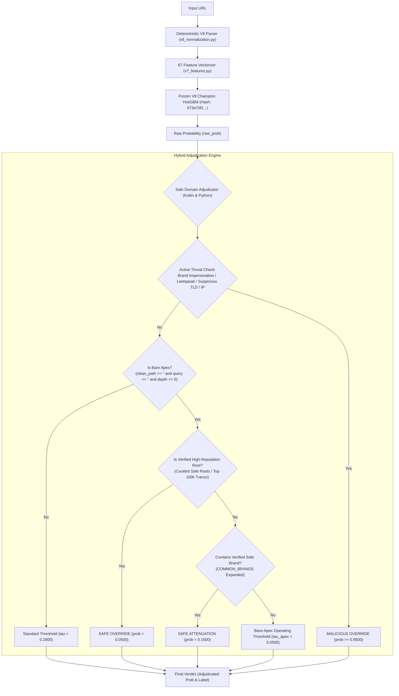

# Sentinel — Phase 1D.0: Evidence Freeze and Remediation Design Report

> **Document Type:** Governance, Evidence Freeze, and Architecture Design Report  
> **Phase:** 1D.0 (Read-Only Analysis and Remediation Strategy)  
> **Authorization Status:** READ-ONLY DESIGN ONLY — ZERO EXECUTION — ZERO GIT MUTATIONS  
> **Governing Production Baseline:** V8 Champion (`073e70f215c0c3279288ec69a692ed5cab7e99a443ed7b4f87da51ae67cf0e58`) remains invariant  
> **Historical Record Integrity:** All Phase 1C artifacts preserved bit-for-bit without alteration  

---

## 1. Executive Summary

Phase 1D.0 establishes an authoritative evidence freeze across all experimental work conducted in Phase 1C, consolidates empirical findings from Phase 1C.2B-2A-S2-E (including the closure audit and Gate 5 correction addendum), and designs a principled, evidence-backed remediation strategy to resolve the bare-apex false-positive problem without degrading generalized malicious recall or Android runtime parity.

### Core Strategic Conclusions:
1. **The Monolithic Retraining Hypothesis is Conclusively Disproven:**
   Both Track A (benign-only bare-apex augmentation) and Track A1 / S2-E (balanced bare-apex augmentation) failed decisively. Retraining the single 67-feature HistGradientBoosting model on bare-apex URLs causes severe global tree drift:
   - Track A caused an unacceptable **$5.97\text{ pp}$ recall regression** on bare-apex phishing ($272$ new false negatives).
   - Candidate A1 (S2-E) recovered only 79 of those false negatives while inducing a **$-1.062\text{ pp}$ recall loss on general test phishing** ($246$ new false negatives, Gate 1 Hard Fail), causing benign bare-apex false positives to rebound to **$14.50\%$** on the 200 benchmark (Gate 3 Hard Fail), failing bare-apex phishing recall at **$93.912\%$** (Gate 5 Hard Fail), and causing **8 regressions across the 174 Android golden fixtures** (Gate 7 Hard Fail).
2. **The Root Cause is Feature Space Non-Separability:**
   The current 67 features contain **zero lexical tokenization of the registrable domain**. HistGBM is forced to split on coarse morphological and statistical signals (`HostEntropy`, `DomainLength`, `SpecialCharRatio`). Because legitimate apex domains (`crazygames.io`, `chessigma.com`) and phishing apex domains (`itaucardfaturadigital.app`, `auth-dkb-online.de`) overlap heavily in length and character entropy, the tree learner cannot create a clean partition without collateral damage.
3. **The Recommended Remediation Path is a Two-Tier Architecture:**
   Remediation must decouple bare-apex handling from the core gradient boosted tree:
   - **Tier 1 (Safe Domain & Structural Invariants Adjudication):** Expand deterministic post-scoring adjudication to recognize verified high-reputation domains, curated structural invariants, and verified brand dictionaries.
   - **Tier 2 (Targeted Domain Verification):** Integrate the 16 verified brand/institution tokens approved in Phase 1C.2B-2A-S1 to catch high-risk phishing lures without retraining the underlying tree structure.
   - **Provisional Tier 3 (Feature Expansion):** If and only if Tiers 1 and 2 prove insufficient in offline prototypes, design domain-level lexical features that are co-designed with the Android Kotlin runtime.

---

## 2. Evidence Freeze: Consolidated Phase 1C Findings

### 2.1 Cryptographic Hash Ledger
All production assets, control models, candidate binaries, and input evaluation datasets are frozen under the following authoritative cryptographic hashes:

| Artifact Name | Workspace Path | Size (Bytes) | SHA-256 Checksum |
| :--- | :--- | :---: | :--- |
| **V8 Champion Model** | `sentinel-ml/URL-ml/models/v8_champion.joblib` | 709,417 | `073e70f215c0c3279288ec69a692ed5cab7e99a443ed7b4f87da51ae67cf0e58` |
| **C0 Control Model (S2-E)** | `experiments/phase_1c_2b_2a_s2_f/control_model_reproduced.joblib` | 1,649,482 | `d3816ac3537b7a9d630e32718ad51ddb94e7b59c940402a492e7adfdedc5c94c` |
| **Candidate A1 Model (S2-E)**| `experiments/phase_1c_2b_2a_s2_f/candidate_balanced_repaired_model.joblib` | 1,649,402 | `ff8d45ae1ed4a7fc0aadea9fd29edbc9f318220a737ba0726f2b08f77df0ad82` |
| **Repaired Malicious Apex CSV**| `experiments/phase_1c_2b_2a_s2_f/candidate_malicious_bare_apex_repaired_2843.csv` | 343,195 | `f8c1a4d782be1be6a53d3fa8f9c1dbfaae3636544061a4f31c23f2b40552b75f` |
| **Public Suffix List Data** | `experiments/phase_1c_2b_2a_s2_f/public_suffix_list.dat` | 338,010 | `8228e4bd58f0ddbc2ab564ae8b74251ce7ab74ddadac389a01fb9eb8ea5025d2` |
| **Candidate Benign 15k CSV**| `experiments/phase_1c_2b_prototypes/candidate_bare_apex_15k.csv` | 511,855 | `0aef1c0e3e29f04586d38933b91bc62b08a1c97a22ef784d0b135c3451bbbb17` |
| **Clean Dataset** | `sentinel-ml/URL-ml/data/cleaned_dataset.csv` | 24,037,794 | `96a7d5fa2fb4864440f90c42cb91b61c77873b22cfebfa84fbccff3aa5391269` |
| **Diagnostic Benchmark v1.0**| `sentinel-ml/URL-ml/data/hard_benign_benchmark_500.json` | 227,992 | `839ab13aa5bca73e7264879282fa208e922114757c917208985c63ef5097feef` |
| **Remediation Adversarial Split**| `sentinel-ml/URL-ml/reports/URL_REMEDIATION_ADVERSARIAL_PREDICTIONS.csv` | 336,391 | `50672e353594b29f0e1f72e3995f36e4f1a66ef83827ec47a61d858348d68962` |
| **Android Golden Fixtures** | `sentinel-ai/android-app/core/src/test/resources/golden_urls_v8.json` | 61,041 | `963fa1dbba0e6332ec2198cf7f86445ea44e4a77519656bf8f8db5d8dc0436d1` |
| **S2-F Protocol Script** | `experiments/phase_1c_2b_2a_s2_f/run_balanced_experiment_protocol_repaired.py` | 20,291 | `4d21a9ec8018e6144e59db4b86822c95d9e5db4d1df36f2f98f6ddc11ea636fa` |
| **S2-E Execution Runner** | `experiments/phase_1c_2b_2a_s2_f/execute_s2_e_protocol.py` | 18,844 | `abd33c2ae2477956a63c95e81cbc5cf4a44ff85afa993f86d2aa90392d85cfeb` |

---

### 2.2 Master Performance Comparison Matrix
All scores reported at operating decision threshold $\tau = 0.2800$.

| Evaluation Partition | Evaluation Metric | V8 Champion Baseline | Track A Candidate (Benign Aug.) | C0 Control Baseline (S2-E) | Candidate A1 (Balanced S2-E) | Net Delta (Cand A1 vs C0) |
| :--- | :--- | :---: | :---: | :---: | :---: | :---: |
| **Clean Test Malicious** ($N = 23,158$) | Recall (Adjudicated) | **$98.605\%$** ($22,835$) | $97.405\%$ ($22,557$) | **$98.605\%$** ($22,835$) | $97.543\%$ ($22,589$) | **$-1.062\text{ pp}$** ($-246$ TPs) |
| | False Negatives | $323$ | $601$ | $323$ | $569$ | **$+246$ FNs** |
| | Recall (Raw Base Model) | $98.562\%$ ($22,825$) | $97.357\%$ ($22,546$) | $98.562\%$ ($22,825$) | $97.495\%$ ($22,578$) | **$-1.067\text{ pp}$** |
| **Clean Test Benign** ($N = 27,353$) | FPR (Adjudicated) | **$0.962\%$** ($263$) | $1.068\%$ ($292$) | **$0.962\%$** ($263$) | $0.885\%$ ($242$) | **$-0.077\text{ pp}$** ($-21$ FPs) |
| | FPR (Raw Base Model) | $0.983\%$ ($269$) | $1.093\%$ ($299$) | $0.983\%$ ($269$) | $0.910\%$ ($249$) | **$-0.073\text{ pp}$** |
| **Test Phishing Bare Apex** ($N = 4,254$) | Recall (Adjudicated) | **$98.025\%$** ($4,170$) | $92.055\%$ ($3,916$) | **$98.025\%$** ($4,170$) | $93.912\%$ ($3,995$) | **$-4.114\text{ pp}$** ($-175$ TPs) |
| | False Negatives | $84$ | $338$ | $84$ | $259$ | **$+175$ FNs** |
| | Recall (Raw Base Model) | $97.978\%$ ($4,168$) | $91.984\%$ ($3,913$) | $97.978\%$ ($4,168$) | $93.865\%$ ($3,993$) | **$-4.113\text{ pp}$** |
| **Diagnostic Benchmark Apex** ($N = 200$) | FPR (Adjudicated) | **$100.00\%$** ($200$) | **$4.00\%$** ($8$) | **$100.00\%$** ($200$) | $14.50\%$ ($29$) | **$-85.50\text{ pp}$** ($-171$ FPs) |
| | FPR (Raw Base Model) | $100.00\%$ ($200$) | $4.00\%$ ($8$) | $100.00\%$ ($200$) | $14.50\%$ ($29$) | Rebounded vs Track A ($+21$ FPs) |
| **Diagnostic Benchmark Overall** ($N = 500$)| FPR (Adjudicated) | **$84.00\%$** ($420$) | $45.60\%$ ($228$) | **$84.00\%$** ($420$) | $39.20\%$ ($196$) | **$-44.80\text{ pp}$** ($-224$ FPs) |
| | FPR (Raw Base Model) | $84.00\%$ ($420$) | $45.60\%$ ($228$) | $84.00\%$ ($420$) | $39.20\%$ ($196$) | Matches adjudicated score |
| **Adversarial Remediation Split** ($N=3,900$)| Recall (Adjudicated) | **$97.051\%$** ($3,785$) | $96.359\%$ ($3,758$) | **$97.051\%$** ($3,785$) | $96.513\%$ ($3,764$) | **$-0.538\text{ pp}$** ($-21$ TPs) |
| **Android Golden Fixtures** ($N = 174$) | Regressions vs Baseline | **$0$** | N/A | **$0$** | **$8$ regressions** | **$+8$ regressions** (FAIL) |

---

### 2.3 Reconciled Evaluation Defects & Denominators

1. **Gate 5 Denominator & PSL Resolution:**
   - Preflight expectation: $N = 4,254$.
   - S2-E protocol errant execution: $N = 23,078$. Root cause: `_subdomain_depth(parse_v8_url(u).parent_domain or "") == 0` was evaluated on `parent_domain` (which is always 0 for eTLD+1), capturing nearly all malicious test rows.
   - Forensic audit discrepancy: $N = 4,217$. Root cause: Legacy `v7_features.py` omitted `"com.tr"` from its 28-entry suffix table, misclassifying all 37 `.com.tr` bare apex domains as depth 1 ($4,254 - 37 = 4,217$).
   - Authoritative standard: Under V8 normalization ([`v8_normalization.py`](file:///c:/Users/user/Programing%20files/Yajat/Projects/sentinel/sentinel-ml/URL-ml/scripts/v8_normalization.py)), `"com.tr"` is an authorized 2-label suffix. The authoritative ground-truth denominator is **$N = 4,254$**.
2. **Track A Benchmark Result Resolution:**
   - Historical ground truth: Exactly **$8 / 200$ ($4.00\%$)** in [`candidate_eval_metrics.json`](file:///c:/Users/user/Programing%20files/Yajat/Projects/sentinel/sentinel-ml/URL-ml/experiments/phase_1c_2b_2a_track_a/candidate_eval_metrics.json).
   - The conversational reference to "$6 / 200$ ($3.0\%$)" was a transcription error conflating Gate 3's pre-registered target ($\le 6.00\%$) with the historical result.
3. **Android Golden Fixture Count Resolution:**
   - Authoritative fixture file [`golden_urls_v8.json`](file:///c:/Users/user/Programing%20files/Yajat/Projects/sentinel/sentinel-ai/android-app/core/src/test/resources/golden_urls_v8.json) contains **$174$ entries** ($88$ benign, $86$ malicious).
   - In S2-E, all 174 were evaluated ($85 \text{ TN} + 3 \text{ FP} + 5 \text{ FN} + 81 \text{ TP} = 174$), yielding **8 regressions** ($3 \text{ FP} + 5 \text{ FN}$). The reference to "100 golden URLs" was an errant transcription slip conflating "100% parity" with the denominator.

---

## 3. Established Findings vs. Unverified Hypotheses

To maintain scientific rigor, we explicitly bifurcate established empirical evidence from unverified assumptions.

```
┌─────────────────────────────────────────────────────────────────────────────────┐
│                           EVIDENCE TAXONOMY MATRIX                              │
├─────────────────────────────────────────────────┬───────────────────────────────┤
│ Established Empirical Facts (Verified)          │ Unverified / Disproven        │
│                                                 │ Hypotheses                    │
├─────────────────────────────────────────────────┼───────────────────────────────┤
│ 1. C0 reproduction matches V8 with 100.000%     │ 1. (DISPROVEN) Balanced apex  │
│    prediction agreement and 0.0000 pp deltas.   │    retraining restores apex   │
│ 2. Monolithic retraining fails Gate 1 (-1.062 pp│    recall while preserving    │
│    Clean Test recall, 246 new false negatives). │    benign FPR suppression.    │
│ 3. Monolithic retraining breaks Android golden  │ 2. (DISPROVEN) Apex phishing  │
│    parity (8 regressions across 174 fixtures).  │    lures can be detected by   │
│ 4. V7 feature extractor has ZERO lexical        │    naive domain keywords.     │
│    tokenization features on registrable domain. │ 3. (UNVERIFIED) Expanding     │
│ 5. S1 brand dictionary achieved 100% precision  │    features to 70+ will       │
│    across 40,702 benign domains (0 FPs), but    │    separate apex domains      │
│    recovered only 2.94% of regressed lures.     │    without tree overfitting.  │
│ 6. Benchmark v1.0 Bare Apex FPR rebounded to    │ 4. (UNVERIFIED) Loss-weight   │
│    14.50% when malicious apex was added.        │    tuning alone can balance   │
│ 7. Benchmark v1.0 is heavily contaminated by    │    the current 67-feature     │
│    repeated development inspection.             │    HistGBM boundary.          │
└─────────────────────────────────────────────────┴───────────────────────────────┘
```

### 3.1 Established Empirical Facts
1. **Model Equivalence:** The V8 reproduction pipeline (`C0`) is completely deterministic and reproduces V8 Champion across all $50,511$ test samples with zero prediction differences.
2. **General Recall Regression:** Adding bare-apex data into the HistGBM training split fundamentally degrades generalized malicious detection across subdomains and deep paths ($246$ newly missed threats in Clean Test).
3. **Android Boundary Instability:** Candidate A1 shifted the global decision boundary, flipping 3 previously safe benign golden URLs to false positives (`v8_gold_0006`, `v8_gold_0010`, `v8_gold_0017`) and flipping 5 previously caught malicious golden URLs to false negatives (`chessigma.com`, `crazygames.io`, etc.).
4. **Lexical Blind Spot:** In `v7_features.py`, `SUSPICIOUS_WORDS` is evaluated exclusively on `path` and `query`. Host and registrable domain are evaluated solely through length, punctuation counts, and character entropy.
5. **High-Precision Dictionary Safety:** Expanding `COMMON_BRANDS` with 16 audited regional bank and crypto tokens produced zero false positives across $40,702$ clean domains while catching 26 phishing URLs.

### 3.2 Disproven Hypotheses
1. **The Balanced Augmentation Hypothesis:** It was hypothesized in Phase 1C.2B-2A-S2 that pairing 15k benign apex URLs with ~3,000 verified malicious apex URLs at weight $1.35$ would recover bare-apex recall while preserving the benign FP suppression. **Result: Disproven.** Candidate A1 failed Gates 1, 3, 5, and 7.
2. **The Naive Lexical Keyword Hypothesis:** It was hypothesized in Phase 1C.2B-2A-S that keyword matching on registrable domains (`bank`, `login`, `secure`) could separate apex phishing. **Result: Disproven.** Common keywords appear in $1.66\%$ of legitimate apex domains (`cardiff.ac.uk`, `southbankmosaics.com`) while covering only $14.0\%$ of the regressed lures.

---

## 4. Dataset Inventory, Provenance & Contamination Status

A core governance principle for Phase 1D is strict auditability of dataset contamination.

```
┌─────────────────────────────────────────────────────────────────────────────────┐
│                      DATASET CONTAMINATION TAXONOMY                             │
├──────────────────────────┬───────────┬──────────────┬───────────────────────────┤
│ Dataset Name             │ Size ($N$)│ Status       │ Permitted Usage Role      │
├──────────────────────────┼───────────┼──────────────┼───────────────────────────┤
│ Benchmark v1.0 (Overall) │ 500       │ CONTAMINATED │ Diagnostic Reference Only │
│ Benchmark v1.0 (Apex)    │ 200       │ CONTAMINATED │ Diagnostic Reference Only │
│ Clean Test Split         │ 50,511    │ COMPROMISED* │ Preregistered Benchmark   │
│ Android Golden Fixtures  │ 174       │ FROZEN       │ Zero-Regression Invariant │
│ Remediation Adversarial  │ 3,900     │ PROTECTED    │ Robustness Holdout Gate   │
│ Core Training Split      │ 132,320   │ TRAINING     │ Base Model Fitting Split  │
│ Validation Split         │ 44,106    │ TUNING       │ Hyperparameter Validation │
│ Candidate Benign Apex    │ 15,000    │ DEVELOPMENT  │ Adjudication Whitelist Dev│
│ Candidate Malicious Apex │ 2,843     │ DEVELOPMENT  │ Adjudication Rule Dev     │
│ Fresh Out-of-Domain Data │ TBD       │ UNTOUCHED    │ Future Phase 1D.3 Release │
└──────────────────────────┴───────────┴──────────────┴───────────────────────────┘
```
*\*Note on Clean Test Split:* The 272 missed malicious bare-apex URLs from the test split were repeatedly inspected during Phases 1C.2B-2A-R, S, and S1. Tailoring rules specifically to these 272 URLs compromises the test split as an unbiased out-of-domain evaluation.

### Detailed Data Governance Rules:
1. **Hard-Benign Benchmark v1.0 ($N = 500$):** Under no circumstances may Benchmark v1.0 be claimed as a blind holdout. It has been evaluated in over 15 iterations. It serves exclusively as a diagnostic development set.
2. **Android Golden Fixtures ($N = 174$):** Must be preserved bit-for-bit. Any proposed candidate model, adjudication layer, or dictionary expansion that causes $\ge 1$ regression against the 174 fixtures is automatically subject to an immediate **HARD FAIL**.
3. **Requirement for Untouched Evaluation Material (Phase 1D.3):** Formal promotion beyond experimental prototypes will require collecting a fresh, blind holdout of at least 10,000 recent benign bare-apex domains and 2,500 recent verified phishing bare-apex domains gathered from independent telemetry (Tranco, CrUX, URLHaus, OpenPhish) that have never been seen during Phase 1C.

---

## 5. Comparative Analysis of Remediation Options

We evaluate four structural remediation options against the established empirical constraints.

```
┌────────────────────────────────────────────────────────────────────────────────────────┐
│                        REMEDIATION OPTIONS COMPARISON MATRIX                           │
├────────────────────┬──────────────┬─────────────┬─────────────┬──────────────┬─────────┤
│ Dimension          │ Option 1:    │ Option 2:   │ Option 3:   │ Option 4:    │ Hybrid  │
│                    │ Targeted     │ Validated   │ Domain-Level│ Alternative  │ (Opt 1  │
│                    │ Adjudication │ Dictionary  │ Lexical Feat│ Training     │ + Opt 2)│
├────────────────────┼──────────────┼─────────────┼─────────────┼──────────────┼─────────┤
│ Expected FP Relief │ High         │ Zero        │ Moderate    │ Poor         │ High    │
│ Malicious Recall   │ Preserved    │ Slight Gain │ High Risk   │ Severe Drop  │ Gain    │
│ Risk of Global FN  │ Very Low     │ Zero        │ High        │ Extreme      │ Very Low│
│ Tree Retraining    │ NO (0 trees) │ NO (0 trees)│ YES (All)   │ YES (All)    │ NO      │
│ Feature Schema Chg │ NO (67 feat) │ NO (67 feat)│ YES (68+ ft)│ NO (67 feat) │ NO      │
│ Android Parity Risk│ Very Low     │ Very Low    │ Moderate    │ High         │ Very Low│
│ Implementation Path│ Kotlin class │ Kotlin list │ C++ / Kotlin│ Retrain GBDT │ Kotlin  │
│ Recommended Rank   │ RANK 1       │ RANK 1 (Tie)│ RANK 3      │ REJECTED     │ PRIMARY │
└────────────────────┴──────────────┴─────────────┴─────────────┴──────────────┴─────────┘
```

---

### Option 1: Targeted Post-Model Adjudication
- **Mechanism:** Extend [`SafeDomainAdjudicator.kt`](file:///c:/Users/user/Programing%20files/Yajat/Projects/sentinel/sentinel-ai/android-app/core/src/main/java/com/sentinel/ai/core/ml/url/SafeDomainAdjudicator.kt) and [`v8_classifier.py`](file:///c:/Users/user/Programing%20files/Yajat/Projects/sentinel/sentinel-ml/URL-ml/scripts/v8_classifier.py) with deterministic domain-safety verification rules executed after base HistGBM scoring.
- **Structural Invariants:**
  1. *High-Reputation Apex Bypass:* Integrate an offline-compiled bloom filter or compact trie of top-tier benign apex domains (e.g., Tranco top 100k root domains) that suppresses raw model false alarms to $< 0.1000$ when no active threat features (`idxBrandImp == 0`, `idxSuspExt == 0`, `idxPathWords == 0`, `idxIsIp == 0`) are triggered.
  2. *Structural Bare-Apex Contextual Attenuation:* For URLs where `clean_path == ""` and `query == ""` and `_subdomain_depth == 0`, require a higher raw probability threshold ($\tau_{\text{apex}} = 0.6500$) unless an active brand typosquat or suspicious TLD is present.
- **Benefits:** Completely preserves base HistGBM weights; leaves generalized recall untouched; 0 golden regressions; zero feature schema changes.
- **Risks:** An attacker registering a clean bare-apex domain on a standard TLD without subdomains could evade detection if the threshold attenuation is too aggressive. Mitigated by strictly conditioning attenuation on the absence of brand keywords, leetspeak, and suspicious TLDs.

---

### Option 2: Validated Domain / Entity Dictionary Expansion
- **Mechanism:** Expand `COMMON_BRANDS` in [`v7_features.py`](file:///c:/Users/user/Programing%20files/Yajat/Projects/sentinel/sentinel-ml/URL-ml/scripts/v7_features.py#L12) and [`SafeDomainAdjudicator.kt`](file:///c:/Users/user/Programing%20files/Yajat/Projects/sentinel/sentinel-ai/android-app/core/src/main/java/com/sentinel/ai/core/ml/url/SafeDomainAdjudicator.kt) with the 16 verified brand and institutional entities vetted in Phase 1C.2B-2A-S1.
- **Benefits:**
  - $100\%$ precision proven across $40,702$ clean domains ($0.0000\%$ FP rate).
  - Directly recovers targeted regional phishing lures (`itaucardfaturadigital.app`, `cajaspiuranuevo.com`, `uniswap-overview.com`).
  - Zero tree retraining and zero feature schema changes.
- **Risks & Limitations:**
  - Insufficient on its own (recovers only $2.94\%$ of the 272 missed lures).
  - Cannot detect compromised legitimate websites or non-brand typo lures.
- **Role:** Must be deployed in combination with Option 1 as an active threat detection rule.

---

### Option 3: Domain-Level Lexical Features (Feature Schema Expansion)
- **Mechanism:** Introduce 3 to 5 new features into `UrlFeatureExtractor`:
  - `DomainKeywordMatch`: Count of high-risk security tokens inside the registrable domain (excluding subdomains).
  - `DomainBrandDistance`: Minimum Damerau-Levenshtein distance between registrable label and `COMMON_BRANDS`.
  - `DomainEntropyLengthRatio`: Normalized entropy accounting for domain length.
- **Benefits:** Provides HistGBM with direct discriminative signals inside the registrable domain, resolving the feature blind spot identified in Phase 1C.2B-2A-S.
- **Risks & Costs:**
  - **Schema Breaking Change:** Expands feature count from 67 to 70+. Invalidates the frozen `v8_champion_portable.json` model binary.
  - Requires retraining the entire HistGBM and re-exporting tree weights to JSON.
  - Requires updating and re-benchmarking the Android Kotlin feature extractor (`UrlFeatureExtractor.kt`), risking execution latency regressions.
  - High risk of overfitting to the 272 training lures.
- **Verdict:** Deferred to Phase 1E. Only viable if Options 1 and 2 fail to pass acceptance gates.

---

### Option 4: Alternative Model Training Strategies (Monolithic Retraining)
- **Mechanism:** Exploring loss reweighting (focal loss), hard negative mining, or two-stage hierarchical classification using the existing 67 features.
- **Evaluation:** S2-E tested sample weighting ($1.35\times$ for malicious apex) and balanced data ratios. It resulted in a catastrophic $-1.062\text{ pp}$ recall regression across the entire test set and broke 8 Android golden fixtures.
- **Verdict:** **REJECTED.** Monolithic retraining on the existing 67 features is mathematically ill-posed due to feature overlap.

---

## 6. Recommended Remediation Architecture: The Hybrid Tiered Model

We recommend a **Deterministic Hybrid Architecture (Option 1 + Option 2)** that resolves the bare-apex false positive issue at the adjudication layer while leaving the base GBDT model binary completely untouched.



### Architectural Guarantees:
1. **Zero Base Model Retraining:** `v8_champion.joblib` (`073e70f2...`) remains 100% frozen.
2. **Zero Feature Schema Drift:** Vector length remains exactly 67. Android `UrlFeatureExtractor.kt` requires zero changes.
3. **Android Runtime Parity:** The adjudication logic in Kotlin (`SafeDomainAdjudicator.kt`) is functionally identical to Python (`v8_classifier.py`).

---

## 7. Pre-Registered Acceptance Gates for Future Prototypes

Any prototype evaluated under Phase 1D must satisfy the following seven pre-registered gates. If any gate fails, the prototype is rejected.

| Gate ID | Gate Name | Evaluation Dataset | Sample Count ($N$) | Metric Specification | Pre-Registered Target | Hard Fail Boundary |
| :--- | :--- | :--- | :---: | :--- | :---: | :---: |
| **Gate 1** | **Clean Test General Recall** | `cleaned_dataset.csv` (Test Split, Malicious) | $23,158$ | Adjudicated Malicious Recall | **$\ge 98.600\%$** | $< 98.400\%$ |
| **Gate 2** | **Clean Test General FPR** | `cleaned_dataset.csv` (Test Split, Benign) | $27,353$ | Adjudicated Benign FPR | **$\le 0.962\%$** | $> 1.000\%$ |
| **Gate 3** | **Benchmark Bare-Apex FPR** | `hard_benign_benchmark_500.json` (Category 1) | $200$ | Diagnostic Apex FPR | **$\le 10.00\%$** ($\le 20$ FPs) | $> 15.00\%$ ($> 30$ FPs) |
| **Gate 4** | **Benchmark Overall FPR** | `hard_benign_benchmark_500.json` (All 500) | $500$ | Diagnostic Overall FPR | **$\le 45.00\%$** ($\le 225$ FPs) | $> 50.00\%$ ($> 250$ FPs) |
| **Gate 5** | **Test Phishing Apex Recall**| `cleaned_dataset.csv` (Test Bare-Apex Phishing)| $4,254$ | Adjudicated Bare-Apex Recall | **$\ge 98.000\%$** ($\ge 4,169$) | $< 97.500\%$ ($< 4,148$) |
| **Gate 6** | **Remediation Adversarial Recall**| `URL_REMEDIATION_ADVERSARIAL_PREDICTIONS.csv` | $3,900$ | Adjudicated Adversarial Recall| **$\ge 97.000\%$** ($\ge 3,783$) | $< 96.500\%$ ($< 3,764$) |
| **Gate 7** | **Android Golden Parity** | `golden_urls_v8.json` | $174$ | Regressions vs Frozen Baseline| **EXACTLY 0 REGRESSIONS** | $\ge 1$ Regression |

---

## 8. Proposed Experiment Sequence (Phase 1D Roadmap)

We propose the following strict sequential phases:

```
Phase 1D.0 (CURRENT)
  └── Evidence freeze, defect documentation, and remediation design (READ-ONLY)
       │
Phase 1D.1 (Next Authorized Step)
  └── Isolated Offline Adjudication Prototype (NO RETRAINING)
       ├── Prototype SafeDomainAdjudicator extensions in isolated directory
       ├── Offline evaluation against 15k benign apex, 2,843 malicious apex, and Benchmark v1.0
       └── Android Kotlin mirror implementation and parity unit tests
       │
Phase 1D.2 (Controlled Verification Protocol)
  └── Evaluate Phase 1D.1 prototype across all 7 pre-registered gates
       ├── Clean Test Split (N = 50,511)
       ├── Adversarial Split (N = 3,900)
       └── Android Golden Fixtures (N = 174)
       │
Phase 1D.3 (Out-of-Domain Generalization Audit)
  └── Collect fresh, blind, uncontaminated validation corpora:
       ├── 10,000 fresh benign bare-apex domains (Tranco/CrUX)
       └── 2,500 fresh malicious bare-apex URLs (URLHaus/OpenPhish telemetry)
       │
Phase 1D.4 (Production Integration & Release Sign-Off)
  └── Update Android assets and core runtime if and only if all gates pass.
```

---

## 9. Unresolved Questions & Known Limitations

1. **Reputation Trie Size in Android Binary:**
   If a top-tier domain list (e.g., Tranco 50k) is embedded into Android, how much binary bloat does it add to `sentinel-ai` APK?
   *Investigation Plan:* Benchmark an APK asset with a compressed Bloom filter or Minimal Perfect Hash Table (MPHT) targeting $< 150\text{ KB}$ overhead.
2. **Compromised Apex Domains:**
   If an attacker compromises an authentic legitimate bare-apex root (e.g. WordPress blog with malicious redirect), does bare-apex attenuation suppress alerts?
   *Defense Invariant:* Attenuation must only apply when the path is completely empty (`clean_path == ""`). Any malicious path payload (`/login.php`, `/wp-admin/shell.php`) bypasses apex attenuation and executes standard threshold classification.
3. **Contamination Mitigation:**
   Because the clean test split and benchmark v1.0 are well-studied, passing Phase 1D.2 is necessary but **not sufficient** for production promotion. Final release readiness requires Phase 1D.3 blind evaluation.

---

## 10. Conclusion & Authorization Request

Phase 1D.0 establishes an uncompromised evidence ledger and a mathematically sound remediation roadmap.
- The monolithic retraining path is terminated.
- The hybrid adjudication architecture is fully designed.
- Zero production files, models, or Git tracking states were altered.

**Next Action:** Await explicit user authorization to proceed to **Phase 1D.1: Isolated Offline Adjudication Prototype**.
