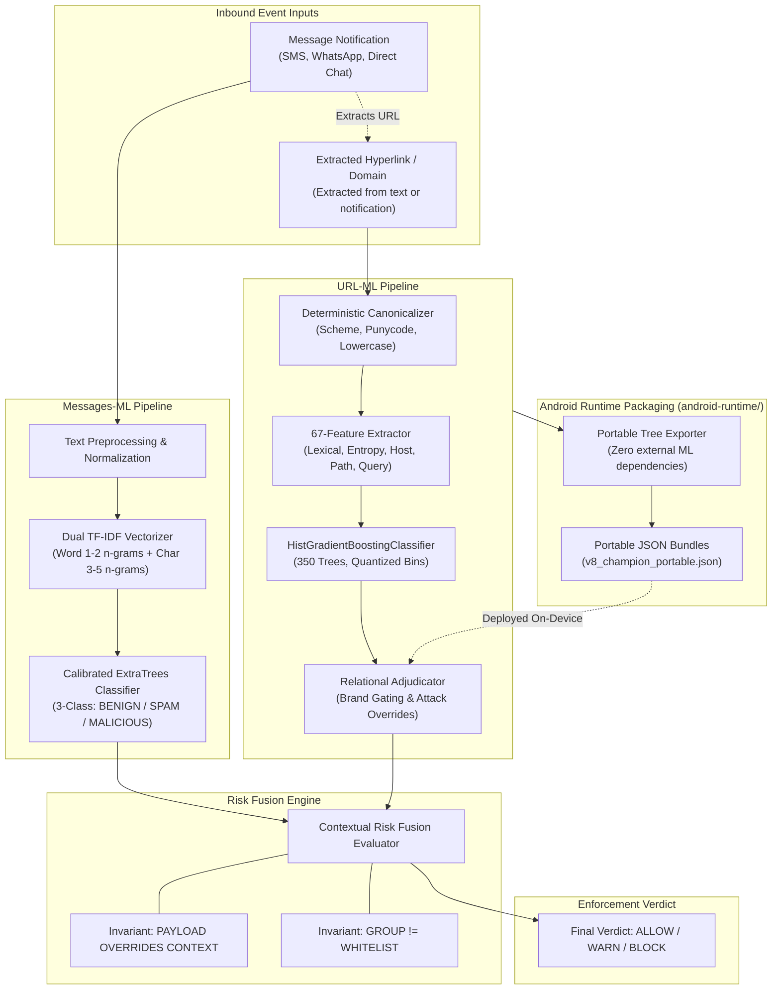

# Sentinel-ML — Machine Learning Architecture & System Design

This document details the machine learning architecture powering the Sentinel threat intelligence system, describing the individual classifiers, feature pipelines, adjudication layers, and the Risk Fusion Engine.

---

## 1. High-Level Architecture Overview

Sentinel provides zero-network, real-time cyber defense on mobile endpoints. The machine learning subsystem operates as two modular classifiers whose signals are integrated by the Risk Fusion Engine:

---

## 2. URL Threat Classification (`URL-ml`)

### 2.1 Model Architecture
- **Classifier**: `HistGradientBoostingClassifier` (scikit-learn gradient-boosted decision trees, 350 trees).
- **Champion Artifact**: [`models/v8_champion.joblib`](file:///c:/Users/user/Programing%20files/Yajat/Projects/sentinel/sentinel-ml/URL-ml/models/v8_champion.joblib) (SHA-256: `073e70f215c0c3279288ec69a692ed5cab7e99a443ed7b4f87da51ae67cf0e58`).
- **Target**: Binary classification (`BENIGN` vs `MALICIOUS`).
- **Note on Taxonomy**: The gradient-boosted decision tree architecture is strictly non-neural and is **not** a Small Language Model (SLM).

### 2.2 Feature Representation
The feature pipeline computes a deterministic 67-dimensional feature vector (`V7_FEATURE_NAMES`):
1. **Lexical & Length Features**: URL character count, host length, path length, query parameter count, dash/dot/slash frequencies.
2. **Structural & Entropy Features**: Shannon entropy across host and path tokens, digit-to-letter ratios, hex-encoded character clusters.
3. **Contextual & Suspicious Indicators**: Presence of known malicious keywords (`login`, `verify`, `banking`, `apk`, `update`, `claim`).
4. **Deterministic Ordering**: All 67 features are sorted alphabetically by feature name, guaranteeing exact index parity between Python and Android Kotlin.

### 2.3 Deterministic Relational Adjudication
Raw model probabilities are post-processed through a rules-based adjudication layer enforcing core security invariants:
- **Locked Safe-Brand Confidence Gating**: Dampens false alerts on verified legitimate domains (e.g. `google.com`, `microsoft.com`) when zero active payload indicators are present.
- **Active Threat Overrides**: If the URL contains an explicit malicious executable or dropper pattern (e.g., `.apk`, `.exe`, open-redirect lures), the threat is immediately escalated to `CRITICAL` regardless of domain reputation.
- **Route Shape Preservation**: Zero path suppression ensures that URLs mimicking authentic authentication portals are not whitelisted purely by parent domain string matching.

---

## 3. Message Threat Classification (`Messages-ml`)

### 3.1 Model Architecture
- **Classifier**: Calibrated `ExtraTreesClassifier` (Extremely Randomized Trees ensemble).
- **Champion Artifacts**: [`champion_model.pkl`](file:///c:/Users/user/Programing%20files/Yajat/Projects/sentinel/sentinel-ml/Messages-ml/champion_model.pkl), [`champion_v2_model.pkl`](file:///c:/Users/user/Programing%20files/Yajat/Projects/sentinel/sentinel-ml/Messages-ml/champion_v2_model.pkl).
- **Target**: Three-class taxonomy:
  1. `BENIGN`: Legitimate transactional, interpersonal, or standard notification messages.
  2. `SPAM`: Unsolicited commercial advertising, non-malicious marketing, or broadcast bulk messages.
  3. `MALICIOUS`: Phishing, smishing, fake lottery/prize claims, credential harvesting, or financial coercion.

### 3.2 Dual TF-IDF Representation
Messages are tokenized and vectorized via a dual TF-IDF pipeline:
- **Word-Level N-Grams (1–2)**: Captures domain terminology, urgency verbs, financial references, and credential solicitations.
- **Character-Level N-Grams (3–5)**: Provides robust resilience against adversarial spelling manipulations, character insertions, leet-speak obfuscations, and punctuation tampering.
- **Normalization Layer**: Unicode NFKC normalization, whitespace standardization, lowercase normalization, and phone/URL token replacement.

---

## 4. The Risk Fusion Engine

The Risk Fusion Engine resides at the application boundary, uniting the message-level and URL-level predictions into a single policy decision:

### 4.1 Core Invariants
1. **`PAYLOAD OVERRIDES CONTEXT`**:
   A conversational or benign message text score (e.g. "hey check this out bro") must **NEVER** suppress a dangerous URL. If `urlSeverity >= EvidenceSeverity.HIGH`, the unified decision MUST evaluate to `WARN` or `BLOCK`.
2. **`GROUP != WHITELIST`**:
   Membership in a trusted group chat (e.g. family group, work channel) is never treated as a blanket bypass. Embedded links are independently adjudicated.
3. **`SEVERITY ESCALATION`**:
   The highest individual evidence severity dictates the operational verdict unless an explicit, verified safe-brand gate without active threat tokens is satisfied.

### 4.2 Verdict Mapping

| Evidence Severity | Message Class | URL Class | Operational Verdict |
| :--- | :--- | :--- | :--- |
| `CRITICAL` | `MALICIOUS` | `MALICIOUS` | `BLOCK` (High-priority alert, user interaction blocked) |
| `HIGH` | `MALICIOUS` or `SPAM` | `MALICIOUS` | `WARN` / `BLOCK` (Immediate warning overlay) |
| `MEDIUM` | `SPAM` | `BENIGN` | `WARN` / `INFO` (Spam banner, links accessible with care) |
| `LOW` / `INFO` | `BENIGN` | `BENIGN` | `ALLOW` (Silent pass-through) |

---

## 5. Portable Android Runtime Bridge (`android-runtime`)

To achieve zero-latency evaluation on mobile without introducing multi-hundred-megabyte native ML libraries:
- **Pure-Kotlin Engine**: `HistGbmTreeEvaluator.kt` evaluates tree nodes, thresholds, and leaf values natively using pure Kotlin floating-point arithmetic.
- **Portable JSON Models**: Model weights, thresholds, and bin quantizations are serialized into `v8_champion_portable.json` (~850 KB), loaded as Android assets.
- **Parity Guarantee**: Validated against the Python reference implementation across the 174-case golden URL suite (`golden_urls_v8.json`), guaranteeing numerical difference $< 10^{-4}$.
