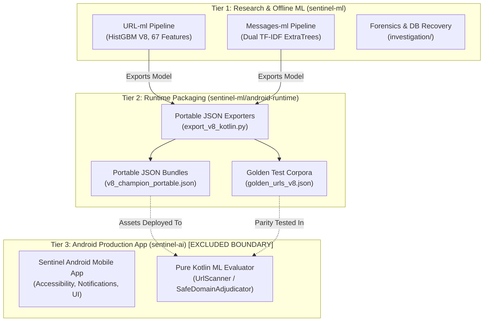

# Sentinel — Workspace Architecture & Project Relationships

This document outlines the high-level architecture of the Sentinel security intelligence ecosystem, mapping the relationships between machine learning pipelines, runtime runtimes, and boundaries.

---

## 1. System Overview & Boundaries

The Sentinel ecosystem is architecturally divided into three operational tiers:

> [!CAUTION]
> **Boundary Isolation:**
> `sentinel-ai/` is an independent, version-controlled Android application repository. No build scripts, maintenance tools, or workspace organization scripts outside `sentinel-ai/` may modify or stage files within its boundary.

---

## 2. Component Descriptions

### 2.1 URL Machine Learning (`sentinel-ml/URL-ml`)
- **Primary Function:** Deterministic feature extraction, adversarial resilience training, benchmark evaluation, and gate validation for URL threats.
- **Champion Artifact:** [`v8_champion.joblib`](file:///c:/Users/user/Programing%20files/Yajat/Projects/sentinel/sentinel-ml/URL-ml/models/v8_champion.joblib) (SHA-256: `073e70f2...`).
- **Feature Pipeline:** 67-dimensional lexical, syntactic, host, path, query, and contextual threat features (`V7_FEATURE_NAMES`).
- **Canonicalization Contract:** Enforces uniform scheme handling (`https://` prepending for missing schemes, trailing delimiter stripping, explicit scheme preservation) identical to Android runtime.

### 2.2 Messages Machine Learning (`sentinel-ml/Messages-ml`)
- **Primary Function:** Natural language threat analysis for SMS, WhatsApp notifications, and direct messaging channels.
- **Champion Artifact:** [`champion_model.pkl`](file:///c:/Users/user/Programing%20files/Yajat/Projects/sentinel/sentinel-ml/Messages-ml/champion_model.pkl).
- **Architecture:** Word (1-2 n-gram) and character (3-5 n-gram) dual TF-IDF vectorization coupled with calibrated tree ensembles.

### 2.3 Android Runtime (`sentinel-ml/android-runtime`)
- **Primary Function:** Intermediate bridge providing pure Kotlin ML tree evaluation without Python, TensorFlow, or ONNX runtime dependencies on mobile.
- **Artifacts:**
  - `v8_champion_portable.json`: Tree nodes, bin thresholds, and base score serialized into zero-overhead JSON.
  - `golden_urls_v8.json`: 174-record golden corpus for cross-language verification.

### 2.4 Forensics & Replay Subsystems
- **`investigation/`:** Forensic recovery tools for SQLite databases (`sentinel_db`, `sentinel_reconstructed.db`), record parsing, and historical row analysis.
- **`7sep_messages_v3/` & `New_history/`:** Replay data and real-device capture streams used for empirical validation of classification models.
- **`scratch/`:** Isolated prototyping and ablation study scripts.

---

## 3. Cross-Language Parity Architecture

To guarantee that offline Python training models match on-device Android behavior to float-precision accuracy:

1. **Deterministic Feature Extraction:** All 67 feature extractors use standard IEEE 754 math, deterministic leet-speak translation, and identical regex tokenization.
2. **Alphabetical Feature Ordering:** Both Python and Kotlin index features strictly alphabetically by name, preventing dimensional mismatch.
3. **Threshold Calibration:** Quantized bin thresholds exported from scikit-learn's `HistGradientBoostingClassifier` are evaluated via exact node-traversal logic in `HistGbmTreeEvaluator.kt`.
4. **Relational Adjudication:** Security invariants (active threat overrides and locked safe-brand gating) execute identically in Python's `V8RelationalURLClassifier` and Android's `SafeDomainAdjudicator`.
